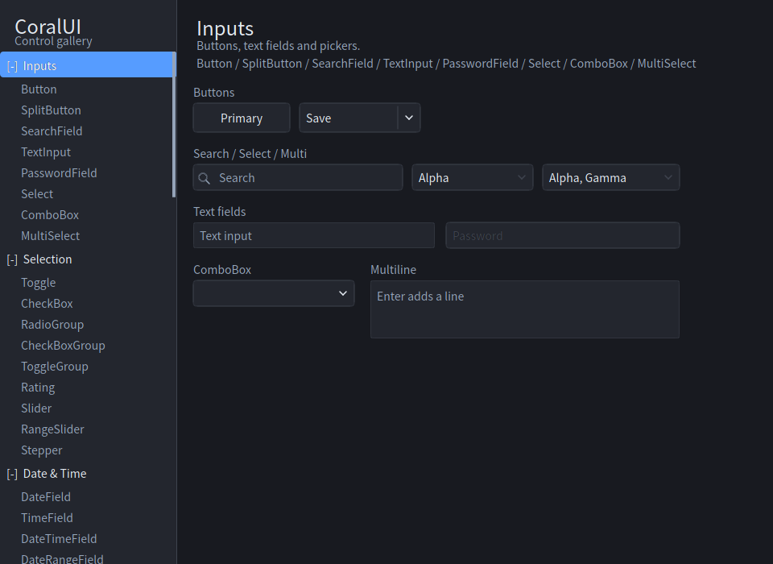
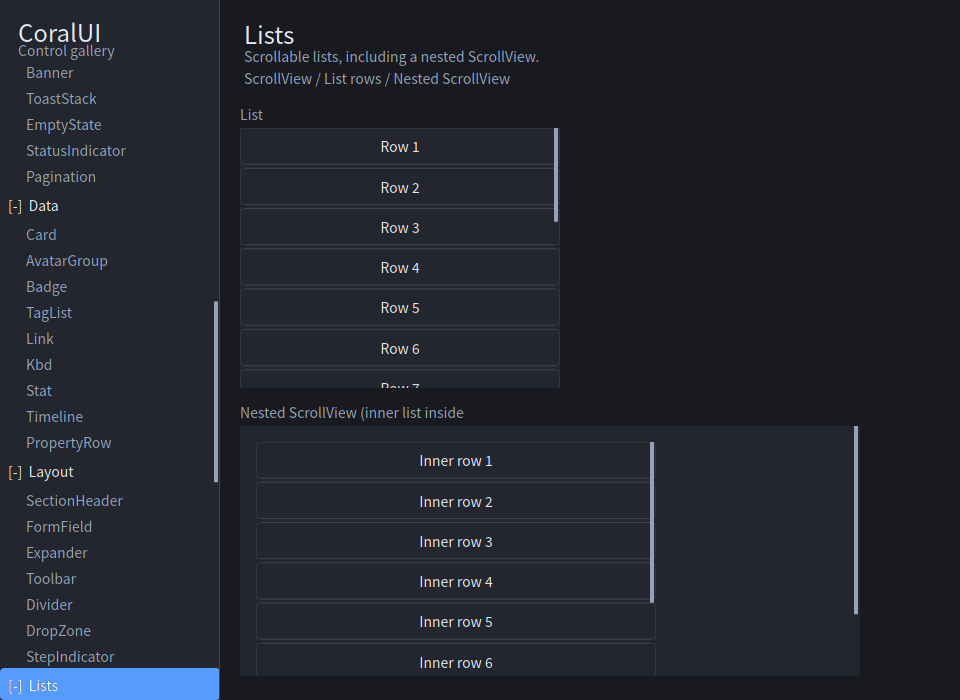
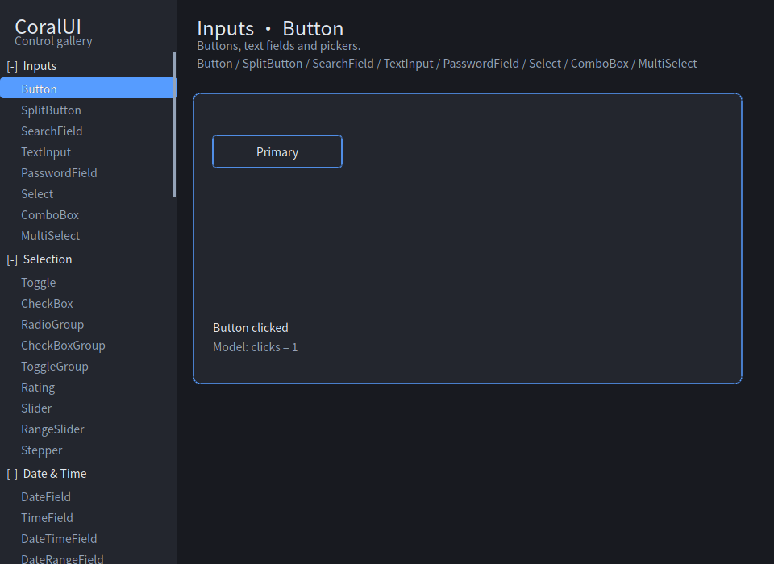

# macOS 通用 GUI 能力补全计划



分区导航：左侧是可滚动的 section 列表，右侧显示所选 section 的控件示例。`Lists` 页验证嵌套
`ScrollView`；`--section N` 可直接截取任一页。



选中控件行会显示 accent 选中框；section 行可展开/闭合。Native 视图延迟到布局完成后再 attach，避免切换
section 时闪到错误位置。



上面的 headless 截图由 `examples/ui/ui_demo.cpp` + `gallery_sections.cpp`（分区 gallery 主界面）生成，
覆盖新增的跨平台控件。

分支：`feature/macos-gui-capabilities`

基线提交：`1a6a656 Add a Cocoa window backend for macOS`

当前推进到 2026-11-24（最新提交见 `git log`；功能提交包括 `50c99cd` / `c6e415b`）。

本文档记录 CoralUI 在 macOS 上距离“通用桌面 GUI 框架”的差距、分阶段任务、开发进度和遇到的问题。每完成一项，更新对应复选框和“进度记录”。

## 1. 当前基线

已经可用的能力：

- 标准 `NSWindow`（系统标题栏、交通灯、窗口拖拽、边缘 resize、zoom、fullscreen、Spaces）；
- `CAMetalLayer` 内容视图，Metal 渲染，Retina 2x；
- same-thread / render-thread 渲染宿主，snapshot；
- 鼠标、右键、中键、滚轮/触控板、基础键盘事件；
- live resize 全分辨率、自适应内容帧节流、系统窗口边框原生平滑；
- `NSPasteboard` 剪贴板（文本/HTML/PNG/文件 URL）；
- `NSOpenPanel` / `NSSavePanel`；
- 系统深浅色、高对比度、reduce motion 查询；
- 系统字体目录发现；
- headless/raster、`ui_native_smoke`、`test_ui`、examples checks。

明确的产品化短板：macOS 后端目前是“原生窗口 + 自绘内容运行时”，还不是完整的 AppKit 级通用 GUI 框架。

### 当前状态（2026-11-24）

- **代码/测试**：`test_ui`、`test_ui_shared_device`、`ui_native_smoke`、`ui_native_ax_smoke`、examples 全部通过。
- **已补齐**：原生菜单/Dock menu、locale、autocorrect、Sidebar outline/edit/drag/context menu、frame-plan 默认、背景材质、focus ring、accent 注入、CoreText 系统字体、字体面板、Share Sheet、打印（含 PDF）、ScreenCaptureKit 截图、UNUserNotificationCenter 授权/投递、SF Symbol tinting。
- **已真实验收**：窗口截图（材质 + focus ring）、字体选择回调、PDF 生成、Share Sheet 打开、字体面板打开/关闭。
- **仍需人工**：打印面板 Print/Cancel、通知授权弹窗与通知中心投递、Share Sheet 最终服务选择、VoiceOver/IME/Finder 拖放。
- **上游依赖**：CoralGraphics `main` 已合入 P3/EDR/PQ、CADisplayLink 和字体 variations/features；CoralUI 已接入请求和 UI API，真实 EDR/PQ 硬件验收仍待补。


## 2. 分阶段任务

### 阶段一：系统集成基础（P0）

目标：让一个真实 macOS 应用可以输入、被辅助功能访问、使用系统菜单、接收拖放并打包发布。

#### 1.1 输入法 / 文本服务（`NSTextInputClient`）

- [x] `CoralUIView` 实现 `NSTextInputClient`；
- [x] `interpretKeyEvents:` 接入 AppKit 文本系统（文本焦点走 IME，非文本焦点/快捷键走原 KeyEvent 路径）；
- [x] marked text / unmark / commit 映射到 `WindowHost::dispatchComposition/Commit`；
- [x] 候选窗定位：`firstRectForCharacterRange:` 使用 `WindowHost::imeCursorRect()` 并转换到屏幕坐标；
- [x] `doCommandBySelector:` 把方向键、退格、删除、回车、Tab、PageUp/Down 等翻译成 `KeyEvent`；
- [x] surrounding text / selected range：UTF-8 字节偏移转换为 UTF-16 范围，供 IME 查询；
- [x] 自动化 native smoke：`ui_native_ax_smoke` 验证 AX role/AXPress 与 marked-text/commit；
- [ ] 中文、日文、韩文输入法手工验证；
- [ ] 死键、Option 变音、emoji picker 验证；
- [ ] marked text 内部 selection / replacementRange / secure input / spell check 仍待补。

验收：在 `ui_demo` 的 `TextInput` 中可以用 macOS 简体中文输入法输入、选择候选词、删除组合文本；`NSTextInputClient` 的标记文本与 CoralUI 的 composition 显示一致。

#### 1.2 Accessibility（NSAccessibility / AXUIElement）

- [x] `CoralUIView` 提供 `CoralAXElement`（`NSAccessibilityElement` 子类）子树；
- [x] 把 `AccessibilityNode` 的 role/name/description/value/state/actions/bounds 映射到 AX 属性；
- [x] 焦点、值变化、选中变化、结构变化事件（`NSAccessibilityPostNotification`，节点路径粒度待细化）；
- [x] 动作回传：AXPress、AXIncrement/AXDecrement、AXScrollToVisible、AXConfirm/AXCancel；
- [x] 自动化 native smoke：`ui_native_ax_smoke` 遍历 AX 树并触发 AXPress；
- [ ] VoiceOver 手工验证；
- [x] 开启/关闭 accessibility bridge：`CORAL_UI_AX=0` 关闭 AppKit AX 树；
- [x] AX 文本：editable/value/selectedTextRange/selectedText、AXSetValue → `TextInput::SetValue`；
- [x] AX 表格/行列语义：rowCount/columnCount/rowIndexRange/columnIndexRange（来自 `AccessibleGrid`）；
- [x] AX hit test（`accessibilityHitTest:` 按屏幕 frame 找最深元素）与 cell/row role；
- [x] AXFocus 通知 post 到当前 focused AX element（无 element 时回退根 view）；
- [ ] VoiceOver 实测 AXFocus 行为；

基础树已验证：`AXGroup` → `AXButton`/`AXTextField`，frame 为屏幕坐标，AXPress 能触发按钮回调。

验收：VoiceOver 能读出 `ui_demo` 的按钮、输入框、列表项，并执行按下/输入焦点跳转。

#### 1.3 应用生命周期与原生菜单

- [x] `NSApplicationDelegate`（`CoralAppDelegate`，单例 app delegate，不覆盖 window delegate）；
- [x] app menu（About / Services / Hide / Hide Others / Show All / Quit；Preferences 待命令 API）；
- [x] Edit menu（Undo/Redo/Cut/Copy/Paste/Delete/Select All，转译为 `KeyEvent` 交给 `TextInput`）；
- [x] Window menu（Minimize / Zoom / Bring All to Front）和 File > Close；
- [x] `CommandRegistry` → 原生 NSMenu：`CommandRegistry::Info{title,group,order}`、`setInfo/info`，Cocoa 动态生成 Commands 菜单并同步 enabled/checked；
- [x] CommandRegistry 菜单合并进标准 File/Edit/View/Window/App（group 名称匹配），未知 group 进入独立 Commands 菜单；
- [x] CommandRegistry `Info.menuIndex`/`separatorBefore`，标准菜单精确插入位置；
- [x] CommandRegistry → macOS Dock menu（`applicationDockMenu:`），按 group 分组并支持 SF Symbol 图标；
- [ ] 自定义顶栏菜单/完全自定义分隔符样式；
- [x] 基础菜单状态校验：Edit 项按 `hasTextFocus()` 启用，其余始终可用；
- [x] `applicationShouldTerminate` / reopen / open files 回调（`ui/ApplicationLifecycle.h`，进程级 handler，可 veto termination）；
- [x] Cmd+Q 先检查所有 Cocoa 窗口的 close interceptor，全部允许后请求关闭并 `NSTerminateLater`，最后一个窗口销毁时 reply YES；任一窗口 veto 则取消 quit；
- [ ] 多 Application 实例的进程级 handler 冲突（AppKit 进程内通常只有一个 Application）；
- [x] 通用原生右键菜单 API（`showNativeContextMenu`，NSMenu/子菜单/check/separator）；
- [x] `Menu`/`ContextMenu` 可选 native presentation（`setNativePresentation` → `showNativeContextMenu`）；默认自动切换待补；
- [x] Cmd+W / Cmd+Q / Cmd+M / Cmd+Z / Cmd+X/C/V/A 等标准快捷键；
- [ ] 自动化测试：菜单项触发与禁用态（目前手工/代码路径验证）。

验收：菜单栏有 App/File/Edit/Window 菜单；编辑菜单能对 `TextInput` 生效；Cmd+Q/Cmd+W 行为稳定（基本完成，待补 CommandRegistry 和生命周期回调）。

#### 1.4 拖放（NSDraggingSource / NSDraggingDestination）

- [x] 注册 `NSPasteboardTypeFileURL` / `NSPasteboardTypeURL` / `NSPasteboardTypeString`；
- [x] `draggingEntered/Updated/Exited/performDragOperation` → `DragEvent`/`DropEvent`；
- [x] 外部落入路径、位置、effect、拖拽光标（文件 URL 主类型 + text/plain secondary）；
- [x] 外部 drag 进入 `WindowImpl::routeExternalDrag()`，与内部 drag 共用目标命中；
- [x] 从 CoralUI 拖出到 Finder/其他 app（`NSDraggingSource` + `NSPasteboardWriting`，文本/文件 URL/custom MIME）；
- [ ] file promise / 多文件（多文件 URL 已解析并以多个 dragging item 发出，promise 未支持）；
- [ ] 验收 demo：把文件拖进窗口，拖出文本/文件（需要真实 Finder 手工测试）。

destination 和基础 source 都已实现；source 的拖拽图像、file promise、取消/多文件体验仍需在真实 Finder 会话中验收。

#### 1.5 Sheet、原生弹窗与文件对话框增强

- [x] `NSAlert` 封装（title/message/buttons/defaultButton/style，sheet + app-modal fallback）；
- [x] window-attached sheet（`beginSheetModalForWindow:` + 主 runloop 等待，非活动窗口回退 app-modal）；
- [x] `NSOpenPanel`/`NSSavePanel` 的 sheet/同步包装；`FileDialogOptions.parent` 通过当前 key/main window 解析；
- [x] UTType 过滤（macOS 11+ `allowedContentTypes`，旧系统 `allowedFileTypes` fallback）；
- [x] 目录选择（`FileDialogOptions::canChooseDirectories/canChooseFiles`）、多选、默认路径；
- [x] 原生 accessory view：`NativeAlertOptions::accessoryView`、`FileDialogOptions::accessoryView`；
- [x] sandbox security-scoped bookmark API：`createSecurityScopedBookmark` / `SecurityScopedAccess`；
- [ ] sandbox-enabled 签名 demo 的 bookmark 读写实测。

#### 1.6 macOS 打包与发布

- [x] `ui_demo` 构建 `.app` bundle（`MACOSX_BUNDLE` + Info.plist 模板）；
- [x] bundle id、版本、display name、`NSHighResolutionCapable`、`NSPrincipalClass`；
- [ ] 图标、minimum system version；
- [x] universal binary：`macos-arm64` / `macos-x86_64` 两个 slice + `scripts/make-universal-demo.sh` lipo 成 universal `.app`；单次 configure 的 universal 仍被 vendored libjpeg-turbo 拒绝；
- [x] 代码签名与 hardened runtime 的 CMake 钩子：`CORAL_MACOS_CODE_SIGN_IDENTITY`、`CORAL_MACOS_HARDENED_RUNTIME`、`CORAL_MACOS_ENTITLEMENTS`；
- [x] notarization 脚本：`scripts/notarize-macos-app.sh`（notarytool submit --wait + stapler staple/validate）；
- [x] sandbox 签名验证：`scripts/check-macos-sandbox.sh`（entitlements 注入 + codesign --verify + sandbox headless launch）；
- [x] release 预检：`scripts/check-macos-release.sh`（Developer ID/hardened runtime/universal/Gatekeeper/notary profile）；
- [x] SDK 安装检查：`scripts/check-install.sh`（临时前缀 + 公共头 + CMake package + macOS native headers）；
- [x] 完整本地 CI：`scripts/check-macos.sh` 7/7 tests + `install layout ok`；
- [x] sandbox bookmark smoke：`ui_demo --bookmark-smoke` 在容器内创建/解析/读取 security-scoped bookmark；
- [x] 真实文件 bookmark 手工入口：`ui_demo --bookmark-panel`（NSOpenPanel + security scope）；
- [x] App Sandbox entitlements 模板：`examples/ui/CoralUIDemo.entitlements`；
- [ ] sandbox-enabled 签名 demo 的 bookmark 读写实测；
- [ ] 文档类型 / URL scheme / open files 声明示例。

验收：`open out/examples/ui/ui_demo.app` 正常启动；签名/公证待后续。

### 阶段二：macOS 原生体验（P1）

- [x] Native Toolbar 基础：`Window::ToolbarItem`、`setToolbarItems/Visible/ActionHandler`、NSToolbar + SF Symbol 图标；
- [x] Sidebar 基础：`Window::SidebarItem`/`setSidebarItems`/selection handler，NSSplitViewController + NSVisualEffectView + NSTableView + SF Symbol；
- [x] Sidebar section/group header（不可选、粗体小字号）；
- [x] Titlebar accessory 基础：`Window::TitlebarAccessoryItem` + NSTitlebarAccessoryViewController + NSSegmentedControl；
- [x] Sidebar outline（`SidebarItem::children`，NSOutlineView，展开/折叠、分组、SF Symbol）；
- [x] Sidebar inline label editing（`SidebarItem::editable` + `setSidebarEditHandler`）；
- [x] Sidebar 拖拽重排（NSOutlineView drag source/drop，`setSidebarMoveHandler`，`moveSidebarItem` 程序化接口）；
- [x] Sidebar 原生上下文菜单（`setSidebarContextActions`/handler，NSMenu 右键触发）；
- [x] 任意 AppKit titlebar accessory view（`setTitlebarAccessoryView`；native smoke 校验）；
- [x] 统一标题栏 + 内容区（`Options::fullSizeContentView` + `Window::safeAreaInsets`）；
- [x] Toolbar `allowsUserCustomization`/`autosavesConfiguration`；
- [x] Toolbar 任意 native view item（`ToolbarItem::nativeView`，native smoke 校验）；
- [x] Toolbar style（Expanded/Preference/Unified/UnifiedCompact）、titlebar visibility、window buttons visibility、flexible space；
- [x] Toolbar separator 专用自定义视图，避免 unified style 合并；
- [x] Toolbar overflow/fullscreen 行为和内容区尺寸联动（content layout + backing size refresh）；
- [x] SF Symbols → `graphics::Image`（`systemSymbolImage`，pointSize/scale，template 标记）；
- [x] 动态 accent color 查询（`SystemAppearance.accentColor`，NSColor.controlAccentColor）；
- [x] accent color 注入当前 Theme（accent/controls.accent/borderFocused），保留原主题以便换色不叠加；
- [ ] 控件 template tinting / 自定义主题保留策略；
- [x] 内容视图系统 focus ring（`setContentFocusRingEnabled`，NSFocusRingTypeExterior）；
- [x] Window background material（`Window::setBackgroundMaterial`，NSVisualEffectView，透明 Metal layer）；
- [ ] 原生控件外观对齐 HIG：按钮、搜索框、下拉框、日期选择、Stepper、 segmented、color well；
- [x] 原生 Popover（`showNativePopover`，NSPopover + NSView）；
- [x] 原生 DatePicker（`ui/DatePickerPanel.h`，NSDatePicker panel）；
- [ ] Sheet、TabView、Outline/Source list、可调整表头；
- [x] 窗口 frame autosave（`Window::Options::frameAutosaveName`）与原生 tabbing 基础（`TabbingMode`、Window 菜单 Show Tab Bar/Merge All Windows）；
- [x] 窗口 restoration 基础：`Options::restorationIdentifier`、`WindowRestoration` factory、NSWindowRestoration/`nativeWindowHandle`；
- [x] CoralUI 窗口布局持久化：`Application::saveWindowLayout/loadWindowLayout`（文本布局文件）；
- [ ] AppKit 完整 state restoration 内容/多窗口顺序；
- [x] macOS secure event input（`Window::setSecureInputEnabled`，Carbon Enable/DisableSecureEventInput，进程级计数）；
- [x] 键盘输入源查询/变化通知：`currentKeyboardInputSource`/`setInputSourceChangedHandler`（TIS distributed notification）；
- [ ] 键盘布局映射/死键；
- [x] Trackpad 手势（magnify/rotate/swipe）→ `GestureEvent`/`Layer::onGesture`；
- [x] Scroll phase/momentum/precise 字段，Cocoa 从 `NSEvent.phase`/`momentumPhase` 映射；
- [ ] Force Touch、pen/pressure；
- [ ] 基于 phase 的滚动/手势识别器（当前 ScrollView 仍只消费 delta，phase 供控件使用）；
- [x] `NSSpellChecker` spell check → UTF-8 byte ranges（`ui/SpellCheck.h`，native smoke 校验 misspelling）；
- [x] `TextInput::setSpellCheckEnabled()` 把 spell issues 画成红色下划线（单行/多行，UTF-8 byte range → 视觉 x）；
- [x] 右键菜单拼写替换建议（TextInput 在 misspelled word 上动态插入 NSSpellChecker suggestions）；
- [x] 空格触发的 NSSpellChecker autocorrect（`TextInput::setAutocorrectEnabled`，默认关闭）；
- [x] 字体面板：`ui/FontPanel.h`，NSFontPanel/NSFontManager 选择转回 `graphics::Font`（CoreText URL）；
- [ ] autocorrect 的逐词撤销/多语言策略；
- [x] CoreText 系统 UI 字体：`systemUIFont(pointSize)`（NSFont → CTFont URL → Typeface → Font）；
- [x] SF Symbol template tinting（`SystemImageOptions::tint`）；
- [x] 字体 variations（`Font::withVariations`，`TextLayer/TextInput::setFontVariations`）与 `TextLayer/TextInput::setFontFeatures`；
- [x] `RichTextRun::features` → `ShapedAdvances`/segment/painter；fallback 逐 run features 仍走 fallback shape；
- [x] 系统 locale / 24 小时制 / 首日星期变化通知；
- [x] 系统 locale 格式化入口：`systemNumberFormat` / `systemDateFormat`；
- [x] `NumberField` 默认使用系统 number format，支持 decimal/grouping separator 解析；
- [x] `DateField` 控件：系统 date format、ISO/本地顺序解析、Up/Down 逐日调整；
- [x] 跨平台 `Calendar` 月历，DateField 默认通过 Popup 打开；
- [x] DateField 可选原生 NSDatePicker（`setNativePickerEnabled(true)`，macOS 扩展）；

### 阶段三：性能、画质与工程化（P2）

- [x] Cocoa 接入 retained frames 与 damage rects（`presentRetained`/`presentDamage`），native smoke 验证 clean frame 不重新录制、damage 后 snapshot 正确；
- [x] Cocoa 默认启用 frame-plan/boundary submission，native smoke 验证 plan items/command buffers；
- [x] CADisplayLink vblank 调度（CoralGraphics `FrameClockApple`）；Cocoa 传 content view，支持 per-window；`CAMetalDisplayLink` render-thread 驱动仍待接；
- [x] occlusion 暂停自动帧（`NSWindowOcclusionState` → `WindowHost::platformOcclusionChanged`，重新可见时 damageAll + requestFrame）；
- [x] 最小化/隐藏时不再由自动循环持续渲染（显式 `Window::renderFrame()` 仍可 snapshot）；
- [x] Display P3 / ExtendedLinearP3(EDR) / HDR10 PQ 输出请求与 `Window::OutputColorSpace`/`FrameStatistics` 上报；实际 EDR 硬件验收待补；
- [x] ScreenCaptureKit 窗口截图；
- [x] Dock badge 与 user attention（`Window::setDockBadge`/`requestUserAttention`）；
- [x] Share Sheet（`Window::showShareSheet`，NSSharingServicePicker）；
- [x] 原生打印与 PDF 导出（`printWindow` / `printToFile`）；
- [ ] macOS CI、原生 UI 自动化、DPR2 golden、性能/内存/能耗基准；
- [ ] 崩溃上报、App Sandbox、公证、自动更新接入。

## 3. 设计决策

- **窗口 chrome**：macOS 始终使用标准 titled `NSWindow`；`Decorations::Client` 映射为 `System`。系统窗口 server 负责拖拽、边缘 resize、zoom、Spaces。自绘标题栏留待阶段二用 titlebar accessory 方案评估。
- **内容视图**：`NSView` 不 flipped，`CAMetalLayer.geometryFlipped = NO`；输入坐标在 `devicePointForEvent` 中翻转。避免纵向 resize 时 drawable 从错误边锚定。
- **resize**：全分辨率渲染，不做半分辨率；内容帧按实际耗时自适应节流；resize 开始不切换 layer 属性，避免闪烁。
- **Metal only**：Cocoa 窗口目前只接 Metal；OpenGL 窗口路径未接。Vulkan 在 Apple 不可用。

## 4. 进度记录

| 日期 | 内容 | 状态 |
|---|---|---|
| 2026-11-23 | 创建分支与本文档；梳理三阶段任务 | 进行中 |
| 2026-11-23 | macOS 原生窗口、系统 chrome、clipboard、file dialog、live resize 基线（`1a6a656`） | 已完成 |
| 2026-11-23 | 创建 `feature/macos-gui-capabilities` 与本文档；阶段一任务拆解 | 已完成 |
| 2026-11-23 | 阶段 1.3：`CoralAppDelegate`、App/File/Edit/Window 菜单、Edit 命令转译、基础菜单校验 | 已完成（CommandRegistry/右键菜单/完整生命周期待补） |
| 2026-11-23 | 阶段 1.3：`ApplicationLifecycle` openURLs/reopen/shouldTerminate handler，native smoke 校验 | 回调完成，自动 quit→close 拦截与多 Application 待补 |
| 2026-11-23 | 阶段 1.3：Cocoa 窗口注册表 + `requestQuit` 尊重 close interceptor，`NSTerminateLater` 在最后一个窗口销毁时 reply；native smoke 校验窗口 veto | 完成 veto 路径，完整 quit 完成路径需手工验收 |
| 2026-11-23 | 阶段 1.6：`ui_demo.app` bundle、Info.plist、版本/标识；headless CTest 从 bundle 内可执行文件运行 | 已完成（签名/公证/universal 待补） |
| 2026-11-23 | 阶段 1.1：`NSTextInputClient`、interpretKeyEvents、marked/commit、候选窗 anchor、doCommandBySelector、UTF-16 selectedRange | 代码完成，待真实中日韩输入法手工验收 |
| 2026-11-23 | 阶段 1.4：`NSDraggingDestination` 外部文件/文本落入、effect 映射、drag cursor | destination 完成，source/file promise 待补 |
| 2026-11-23 | 阶段 1.2：`CoralAXElement` 子树、role/value/frame/state 映射、AXPress/Increment/Decrement/ScrollToVisible、通知 | 基础 bridge 完成，VoiceOver/Text AX 待补 |
| 2026-11-23 | 阶段 1.2 AX 文本：TextInput 暴露 accessibleValue，CoralAXElement 映射 editable/value/selection，AXSetValue 走 SetValue action | 文本 AX 基础完成，表格/焦点/hit test 待补 |
| 2026-11-23 | 阶段 1.2 AX 表格：grid rowCount/columnCount/index ranges，native smoke 用 Table 校验 2x2 | 表格尺寸完成，cell role/hit test 待补 |
| 2026-11-23 | 阶段 1.2 AX hit test/cell：`accessibilityHitTest:`、grid cell → AXCell、ListItem → AXRow；native smoke 校验按钮命中 | 完成基础命中，AXFocus 待补 |
| 2026-11-23 | 阶段 1.2 AXFocus：通知改为 post 到 focused AX element；无匹配时回退根 view | 完成通知目标，VoiceOver 实测待补 |
| 2026-11-23 | 阶段 1.4 source：`CoralDragSource`、文本/文件/custom MIME、拖拽图像 | 基础 source 完成，file promise/真实 Finder 验收待补 |
| 2026-11-23 | 阶段 1.5：文件对话框 sheet、UTType 过滤（UniformTypeIdentifiers）、默认路径/多选 | 部分完成，NSAlert/accessory/sandbox bookmark 待补 |
| 2026-11-23 | 阶段 1.5：`NativeAlert.h` / NSAlert sheet 封装，native smoke 校验 `supportsNativeAlerts` | NSAlert 基础完成，真实弹窗手工验收/accessory 待补 |
| 2026-11-23 | 阶段 1.6：`CORAL_MACOS_CODE_SIGN_IDENTITY` / `CORAL_MACOS_HARDENED_RUNTIME` / entitlements 签名钩子；ad-hoc 签名实测通过 | 签名钩子完成，notarization/sandbox/universal preset 待补 |
| 2026-11-23 | 阶段 1.6 universal：`CMakePresets.json` arm64/x86_64 preset、host shader compiler 复用、`scripts/make-universal-demo.sh` lipo 验证 dual-arch；notarization 脚本 | universal/notarization 脚本完成，真实公证/sandbox 待补 |
| 2026-11-23 | 工程化：`scripts/check-macos.sh` 本地 CI（preset 构建 + test_ui/native/example），实测 6/6 | 本地 CI 完成，托管 CI/性能门禁待补 |
| 2026-11-23 | macOS libc++ 兼容：浮点 `from_chars` 改为 `strtof`（ElementSpec/ThemeFile），整数 from_chars 显式 base；parser 测试 23/23 | CI 编译修复 |
| 2026-11-23 | Xcode 16.4 SDK 兼容：`NSAccessibilityScrollToVisibleAction`（macOS 26）改为稳定的 `@"AXScrollToVisible"` 字符串；修复 SpellCheck 源码中的 NUL 字面量 | CI 编译修复 |
| 2026-11-23 | CoralGraphics Metal fallback texture：`replaceRegion:` 需要 CPU 可见存储，改为 `MTLStorageModeShared`，修复 GitHub macOS 15 paravirtual Metal 上所有 Metal 初始化的 SIGSEGV | CoralGraphics main `dca68f7` |
| 2026-11-23 | 系统 locale：`SystemLocale`（identifier/language/24h/firstWeekday/数字分隔符）+ locale/timezone 变化通知；native smoke 读取 zh_CN | 查询/通知完成，日期/数字控件接入待补 |
| 2026-11-23 | Spell autocorrect：`spellCorrection` + TextInput 空格触发替换（默认关闭），native smoke 校验 helo→help | 基础完成，逐词撤销/字体面板待补 |
| 2026-11-23 | Unicode 性能门禁从 `test_ui` 正确性 suite 分离（保留 `unicode_perf_gate`），流式预算放宽到 10x；paravirtual CI 上 1 个性能测试误报 | CI 绿色化，性能门禁已独立 |
| 2026-11-23 | 阶段 1.6 sandbox：entitlements 模板 + security-scoped bookmark API；非 sandbox 环境下创建 bookmark 按预期失败 | API/模板完成，sandbox 签名实测待补 |
| 2026-11-23 | 新增 macOS native smoke：`ui_native_ax_smoke`（AX role/tree/AXPress + NSTextInputClient marked/commit） | 已加入 CTest native label |
| 2026-11-23 | 阶段 2 起步：`Window::Options::frameAutosaveName`/`TabbingMode`、AppKit frame autosave、tabbingIdentifier、Window 菜单 tab 项 | 基础完成，完整 restoration/titlebar accessory 待补 |
| 2026-11-23 | 阶段 2 Toolbar：`Window::ToolbarItem`/`setToolbarItems`/handler、NSToolbar delegate、SF Symbol 图标；native smoke 校验 item/action | 基础完成，Sidebar/自定义/尺寸联动待补 |
| 2026-11-23 | 阶段 2 Sidebar：`Window::SidebarItem`/selection、NSSplitViewController + visual-effect sidebar + NSTableView；native smoke 校验 split item/rows/selection | 基础完成，分组/outline/titlebar accessory 待补 |
| 2026-11-23 | 阶段 2 Sidebar outline：`SidebarItem::children` → NSOutlineView，递归节点、展开全部、分组/选择；native smoke 校验嵌套 child 行 | 基础完成，拖拽/编辑待补 |
| 2026-11-23 | 阶段 2 Sidebar edit：`SidebarItem::editable` + `setSidebarEditHandler`，NSTextField 提交回 ID/新 label；native smoke 校验 Renamed | 完成行内编辑，拖拽/context menu 待补 |
| 2026-11-23 | 阶段 2 Sidebar drag：NSOutlineView 拖拽源/落点、树内重排、`setSidebarMoveHandler`；native smoke 校验 two 移到根首 | 完成程序化/拖拽重排，真实鼠标拖拽待手工验收 |
| 2026-11-23 | 阶段 2 Sidebar context menu：`setSidebarContextActions`/handler，NSMenu 右键项回调 item/action；native smoke 校验 Rename | 基础完成，真实右键菜单待手工验收 |
| 2026-11-23 | 阶段 2 Sidebar section header + Toolbar customization/autosave；native smoke 校验 group row 与选择 | 分组完成，outline/titlebar/custom toolbar 细节待补 |
| 2026-11-23 | 阶段 2 titlebar accessory：`TitlebarAccessoryItem`、trailing NSTitlebarAccessoryViewController、NSSegmentedControl、selection | 基础完成，任意 accessory view/leading 布局待补 |
| 2026-11-23 | 阶段 2 secure input：`setSecureInputEnabled`/`isSecureInputEnabled`，Carbon 安全事件输入，native smoke 校验 | 完成基础能力，进程级/多窗口语义待补 |
| 2026-11-23 | 阶段 2 键盘输入源：TIS current ID/name + `kTISNotifySelectedKeyboardInputSourceChanged` 主队列回调；native smoke 读取 SCIM | 查询/通知完成，布局/死键待补 |
| 2026-11-23 | 阶段 2 spell check：`ui/SpellCheck.h` + NSSpellChecker，UTF-16→UTF-8 byte ranges，native smoke 校验 | API 完成，TextInput 下划线/autocorrect/字体面板待补 |
| 2026-11-23 | 阶段 2 系统字体：`systemUIFont` 通过 CoreText 解析 SFNS 并创建 graphics::Font；native smoke 校验 measureWidth | 基础完成，字体面板/variations 待补 |
| 2026-11-23 | 阶段 3 平台服务：`setDockBadge`/`requestUserAttention`，native smoke 校验 badge 读写 | Dock badge 完成，通知/Share Sheet/打印待补 |
| 2026-11-23 | 阶段 3 平台服务：`showShareSheet`（NSSharingServicePicker，anchor 转视图坐标），native smoke 校验能力 | Share Sheet 基础完成，真实分享面板待手工验收 |
| 2026-11-23 | 阶段 2 accent color：`SystemAppearance.accentColor` 从 NSColor.controlAccentColor 填充；native smoke 校验 | 完成查询，Theme 注入待补 |
| 2026-11-23 | 阶段 2 accent 注入 Theme：accent/controls.accent/borderFocused，保留 base theme；native smoke 校验红色注入/恢复 | 完成基础注入，template tinting 待补 |
| 2026-11-23 | 阶段 2 内容 focus ring：`setContentFocusRingEnabled` + NSFocusRingTypeExterior/drawFocusRingMask；native smoke 校验 | 基础完成，逐控件 focus 语义待补 |
| 2026-11-23 | 阶段 3 UNUserNotificationCenter：授权查询/请求 + 通知投递，CLI 回退 NSUserNotificationCenter；native smoke 校验能力 | 基础完成，交互/附件待补 |
| 2026-11-23 | 阶段 3 ScreenCaptureKit：`captureWindow` 同步等待 shareable content + SCScreenshotManager，10s 超时 | 编译/能力完成，权限交互待手工验收 |
| 2026-11-23 | 阶段 2 template tinting：`SystemImageOptions::tint` 以 SourceAtop 着色 SF Symbol；native smoke 校验输出 | 完成基础 tint，动态 tint 待补 |
| 2026-11-23 | 阶段 3 通知：`postUserNotification`/`supportsUserNotifications`（NSUserNotificationCenter）；native smoke 校验能力 | 基础完成，UNUserNotificationCenter/授权待补 |
| 2026-11-23 | 阶段 3 屏幕录制权限：`ui/ScreenCapture.h`，preflight/request；native smoke 校验非 Unavailable | 权限 API 完成，实际窗口截图/授权流程待补 |
| 2026-11-23 | 阶段 3 打印：`printWindow` 将当前 snapshot 编码 PNG → NSImage → NSPrintOperation；native smoke 校验能力 | 基础完成，打印面板/分页待手工验收 |
| 2026-11-23 | 阶段 2 背景材质：`BackgroundMaterial` + NSVisualEffectView 容器，Metal layer 透明；native smoke 校验 effect 安装 | 基础完成，真实 vibrancy/focus ring 待手工验收 |
| 2026-11-23 | 阶段 2 透明文本：根因是 subpixel 文本 channel mask 不写 alpha；`RenderContext` 标记目标 opacity，非 opaque 时走 grayscale 文本 | 正确修复，新增透明 clear 回归测试并更新真实验收截图 |
| 2026-11-23 | 阶段 2 字体面板：`showFontPanel`/`hideFontPanel`，NSFontPanel 选择经 CTFont URL 转回 graphics::Font；native smoke 校验能力 | 基础完成，面板交互/variations 待手工验收 |
| 2026-11-23 | 阶段 2 spell check UI：TextInput `setSpellCheckEnabled` 自动查询并绘制单行/多行红色下划线 | 下划线完成，右键建议/autocorrect/字体面板待补 |
| 2026-11-23 | 阶段 2 spell suggestions：`spellSuggestions` + TextInput 动态右键菜单替换 word range；native smoke 校验 8 个候选 | 右键建议完成，autocorrect/字体面板待补 |
| 2026-11-23 | 阶段 2 输入：`GestureEvent`/`ScrollPhase`/`onGesture`，Cocoa magnify/rotate/swipe 与 scroll phase/momentum 映射 | 基础完成，Force Touch/pen 与基于 phase 的识别器待补 |
| 2026-11-23 | 阶段 2 SF Symbols：`ui/SystemImage.h`、NSImage symbol 光栅化、非 Apple fallback、native smoke 40x40 验证 | 基础完成，tinting/accent color 待补 |
| 2026-11-23 | 阶段 3 渲染：Cocoa `supportsRetainedFrames`/`presentRetained`/`supportsDamageRects`/`presentDamage`；native smoke 验证 retained replay 与 damage snapshot | retained/damage 完成，frame-plan/boundary 待补 |
| 2026-11-23 | 阶段 3 occlusion：Cocoa occlusionState → platformOcclusionChanged；自动 tick 在隐藏时保留待渲染请求 | 基础完成，手工隐藏/最小化验收待补 |
| 2026-11-23 | 阶段 3 vblank：CoralGraphics CVDisplayLink `MacVBlankSource` + `NativeDisplayKind::MacOS`；Cocoa 返回真实 display source，native smoke 校验 refreshHertz > 0 | 基础完成，CVDisplayLink 弃用/per-window 显示切换待补 |
| 2026-11-23 | 阶段 3 HDR 基础：NSScreen `maximumExtendedDynamicRangeColorComponentValue`/Display P3 colour space → `Window::displayHeadroom`/`supportsWideColor` | 上报完成，实际 EDR/PQ 输出待 CoralGraphics |
| 2026-11-23 | 阶段 3 frame-plan：Cocoa boundary submission、WindowSurface 复用 open frame；native smoke plan items=1/buffers=1 | 默认启用完成，更多滚动/overlay 场景待补 |
| 2026-11-23 | 阶段 3 frame-plan 默认启用（不再依赖 CORAL_UI_FRAME_PLAN_WINDOW）；UI/native/example 套件通过 | 完成默认启用 |

| 2026-11-24 | 打印/面板流程：`printToFile` 无面板生成 PDF，native smoke 校验文件非空；字体面板通过 setSelectedFont + changeFont 验证选择回调 | 实际 PDF 输出与字体选择已验证；打印面板取消仍待人工 |
| 2026-11-24 | 透明目标文本正确修复：`RenderContext` 暴露 opacity，`TextPainter` 在非 opaque 目标禁用 subpixel mask，新增 headless 回归测试 | 完成，移除 1/255 workaround |
| 2026-11-24 | Share Sheet 打开与字体面板生命周期加入 native smoke；真实窗口截图更新 | 打开/关闭验证完成，最终选择待人工 |
| 2026-11-24 | 文档更新：新增当前状态摘要，修正 spell/font/locale/print/screenshot 勾选与人工验收边界 | 已完成 |
| 2026-11-24 | README/modules/ui README：macOS IME、DnD、Accessibility、native chrome 能力表更新 | 已完成 |
| 2026-11-24 | 接入 CoralGraphics 新能力：主屏 CADisplayLink、DisplayP3/EDR/HDR10 `Window::Options.outputColorSpace`、字体 variations/features；native smoke 校验字体轴/feature shaping，demo 新增 `--color-space` | 代码接入完成，EDR 硬件/PQ 视觉待手工 |
| 2026-11-24 | TextInput 字体 features：`setFontFeatures` 贯穿 shaping/measure/painter；HDR 请求窗口验证 fallback 与统计一致；native smoke 打印 colorSpace/hdr | 完成，RichText 逐 run features 待补 |
| 2026-11-24 | RichText 逐 run features：run → shaped advances/segment/painter，新增 segment feature 回归测试 | 完成基础链路，fallback features 待补 |
| 2026-11-24 | DateField 原生弹层：点击调用 `showNativeDatePicker`，回调更新日期并触发 onChanged；析构关闭面板 | 完成点击集成，真实交互待人工 |
| 2026-11-24 | DateField 新控件：`systemDateFormat`、ISO/本地日期解析、Up/Down 逐日、onChanged；headless 测试覆盖 | 完成基础日期输入，日历弹层/本地化月份名待补 |
| 2026-11-24 | NumberField 接入系统 locale：默认 `systemNumberFormat`，显示/解析 decimal/grouping separator；日期控件待补 | 完成 NumberField，DatePicker 待补 |
| 2026-11-24 | 系统 locale 格式化：`systemNumberFormat`/`systemDateFormat` 使用 NSCurrentLocale 分隔符与日期顺序；native smoke 校验输出 | 完成格式化入口，控件默认接入待补 |
| 2026-11-24 | Toolbar flexible space/separator：`ToolbarItem::flexibleSpace/separator` → NSToolbar 标准 identifier；native smoke 校验 flexible space | flexible space 完成，separator 在 unified style 下被 AppKit 合并 |
| 2026-11-24 | Calendar 本地化：`SystemLocale` 增加系统月份/星期名称，Calendar 使用系统首日；DateField Escape 关闭弹层；test_ui 覆盖 Popup | 完成系统 locale 数据，非 macOS fallback 为英文 |
| 2026-11-24 | 样式名补齐：NumberField/SearchField/TextInput 默认 style name | 便于统一 StyleSheet |
| 2026-11-24 | ComboBox AX 同步：文本输入/删除/键盘编辑后更新 accessibleValue；test_ui 覆盖 | 完成编辑可访问值 |
| 2026-11-24 | 样式接入：DateField/TimeField/TimePicker/ProgressBar 默认 style name，Expander clipsToBounds；便于 StyleSheet/HIG 统一 | 完成样式钩子，视觉回归待人工 |
| 2026-11-24 | 控件画廊合并进 `ui_demo`：gallery 作为主界面，同时保留 .app/AX/IME/acceptance 路径；headless 测试输出 `docs/images/control-gallery.png` | 完成单一验收二进制 |
| 2026-11-24 | Banner exit animation：fade/slide out + onDismiss；test_ui 覆盖 | 完成出场动画 |
| 2026-11-24 | Banner enter animation：opacity + 6px slide, 180ms；test_ui 覆盖 | 完成入场动画 |
| 2026-11-24 | Banner icon：可选 leading image，参与绘制；test_ui 覆盖 accessor | 完成图标入口 |
| 2026-11-24 | Banner 加入 gallery：Success/Undo/dismiss 视觉验收 | 完成画廊反馈控件 |
| 2026-11-24 | 跨平台 Banner：severity/action/dismiss/Escape/AX；test_ui 覆盖 | 完成 inline message bar |
| 2026-11-24 | Card/Expander 标题分隔线：theme border 1px | 完成容器分隔视觉 |
| 2026-11-24 | 跨平台 Divider：Horizontal/Vertical、thickness/color/theme；test_ui 覆盖 | 完成基础分隔线 |
| 2026-11-24 | Gallery loading：Spinner + 多行 Skeleton 进入 ui_demo 画廊 | 完成加载态视觉 |
| 2026-11-24 | Gallery light 更新：ProgressRing/Toolbar/icons 后重新生成亮色截图 | 完成双主题视觉同步 |
| 2026-11-24 | Gallery light theme：新增 `--theme light` headless 测试和截图，验证主题 token 覆盖新控件 | 完成双主题视觉 |
| 2026-11-24 | Gallery Rating：3.5/5 半星与 Badge/Chip/Avatar 同区展示 | 完成评分控件视觉 |
| 2026-11-24 | Gallery Avatar：26px initials + presence dot，验证圆形裁剪/状态点 | 完成头像视觉 |
| 2026-11-24 | Toolbar 画廊：Expander 内容中的 One/Two 工具栏，同时修正 Toolbar 使用固定 44px 高度而非拉伸 | 完成工具栏视觉 |
| 2026-11-24 | Gallery icons：生成 16px 圆形 Image，驱动 Badge/Chip/Banner/EmptyState 图标路径 | 完成图标视觉 |
| 2026-11-24 | Gallery EmptyState：Card 内零状态 title/description/action，验证嵌套布局 | 完成零状态视觉 |
| 2026-11-24 | Gallery StatusBar：底部提示/右侧 gallery 标识，验证 StatusBar 实际布局 | 完成状态栏画廊展示 |
| 2026-11-24 | EmptyState content：可选中间内容区，measure/layout 纳入；test_ui 覆盖 | 完成零状态内容槽 |
| 2026-11-24 | EmptyState icon：可选 28px leading image，标题下移；test_ui 覆盖 accessor | 完成零状态图标 |
| 2026-11-24 | 跨平台 EmptyState：title/description/action，AX Group，emptystate style；test_ui 覆盖 | 完成零状态容器 |
| 2026-11-24 | StatusBar tab order：leading 左到右、trailing 左到右连续编号；test_ui 覆盖 | 完成键盘顺序 |
| 2026-11-24 | StatusBar leading items：addLeadingItem 从左布局，leftText 让位；test_ui 覆盖 | 完成两侧操作区 |
| 2026-11-24 | StatusBar 多 trailing items：addTrailingItem 从右向左布局；test_ui 覆盖 | 完成状态栏操作组 |
| 2026-11-24 | StatusBar trailing item：右侧控件布局，文本让位；test_ui 覆盖 | 完成状态栏操作区 |
| 2026-11-24 | 跨平台 StatusBar：left/right/measure/height/AX value；test_ui 覆盖 | 完成状态栏容器 |
| 2026-11-24 | Toolbar clear：清理自动 overflow menu，避免旧项残留；test_ui 覆盖 | 完成 overflow 生命周期 |
| 2026-11-24 | 原生 Toolbar HIG：自定义 1px separator 避免 unified 合并；toolbar 显隐/样式/全屏后刷新 content layout 与 backing size | 完成内容区联动；真实 fullscreen 人工验收待补 |
| 2026-11-24 | Toolbar auto overflow：addItem(label, action) 自动生成 overflow Menu 项；test_ui 覆盖 | 完成自动菜单映射 |
| 2026-11-24 | Toolbar overflow 细化：隐藏 separator、visible tab 顺序、overflow button tab 最后；test_ui 保持 | 完成 overflow 细节 |
| 2026-11-24 | Toolbar overflow：setOverflowMenu + hidden items + “...” button，hasOverflow 查询；test_ui 覆盖 | 完成基础 overflow |
| 2026-11-24 | 跨平台 Toolbar：measure/layout fixed/flexible/separator，theme surface；test_ui 覆盖 | 完成工具栏容器 |
| 2026-11-24 | Banner running animation：mExitPending 纳入 hasRunningAnimation；test_ui 覆盖 | 完成退出动画帧调度 |
| 2026-11-24 | 帧调度审计：TextInput caret、Tooltip pending、Toast deadline 报告 hasRunningAnimation；test_ui 覆盖 | 修复空闲停帧 |
| 2026-11-24 | Style hooks 补齐：TabBar/Tooltip/Toast/Popup/Menu/Dialog/TitleBar/Table/TreeView/ListView | 完成统一 StyleSheet 入口 |
| 2026-11-24 | ColorPicker style：默认 `colorpicker` style hook；test_ui 覆盖 | 完成样式接入 |
| 2026-11-24 | ColorPicker value sync：setPalette/setMode 同步；无 palette 选中时 value 为空；test_ui 保持 | 完成空值语义 |
| 2026-11-24 | ColorPicker palette SetValue：精确命中 palette 则选中，否则切 HSV；test_ui 覆盖 | 完成颜色设置映射 |
| 2026-11-24 | ColorPicker AX：SetValue `#RRGGBB[AA]`，自动切 HSV 并回调；test_ui 覆盖 | 完成颜色设置语义 |
| 2026-11-24 | Style hooks 补齐：TabBar/Tooltip/Toast/Popup/Menu/Dialog/TitleBar/Table/TreeView/ListView | 完成统一 StyleSheet 入口 |
| 2026-11-24 | ColorPicker style：默认 `colorpicker` style hook；test_ui 覆盖 | 完成样式接入 |
| 2026-11-24 | ColorPicker value sync：setPalette/setMode 同步；无 palette 选中时 value 为空；test_ui 保持 | 完成空值语义 |
| 2026-11-24 | ColorPicker palette SetValue：精确命中 palette 则选中，否则切 HSV；test_ui 覆盖 | 完成颜色设置映射 |
| 2026-11-24 | ColorPicker AX：Group/name + #RRGGBB value，选择/HSV 更新同步；test_ui 覆盖 | 完成颜色可访问值 |
| 2026-11-24 | ProgressRing AX：indeterminate 时 accessibleValue=Loading；test_ui 覆盖 | 完成加载语义 |
| 2026-11-24 | ProgressRing indeterminate：旋转 1/4 圆弧 + onFrame + running flag；画廊展示 | 完成圆形不确定进度 |
| 2026-11-24 | Rating state sync：setStars clamp 后同步 AX；setHalfSteps 重新量化；test_ui 覆盖 | 修正评分状态一致性 |
| 2026-11-24 | Rating AX half value：3.5 输出 "3.5" 而非 floor；test_ui 覆盖 | 修正半星读屏文本 |
| 2026-11-24 | Rating half steps：double rating + 0.5 量化、半星裁切绘制、AX step；test_ui 覆盖 | 完成半星评分 |
| 2026-11-24 | Rating read-only：忽略指针/键盘/AX SetValue，focusable=false；test_ui 覆盖 | 完成只读评分 |
| 2026-11-24 | 跨平台 Rating：星形绘制、点击/拖动/Home/End、Slider range/SetValue；test_ui 覆盖 | 完成评分控件 |
| 2026-11-24 | 跨平台 ProgressRing：48 段圆环、value clamp、ProgressIndicator/range；test_ui 覆盖 | 完成圆形进度 |
| 2026-11-24 | ProgressBar running animation：indeterminate 持续请求帧；test_ui 覆盖 | 修复动画停帧 |
| 2026-11-24 | Skeleton running animation：mAnimating 驱动 hasRunningAnimation，窗口持续出帧；test_ui 覆盖 | 修复 pulse 停在首帧 |
| 2026-11-24 | Spinner 语义：ProgressIndicator role、Loading value、spinner style hook；test_ui 覆盖 | 完成加载指示语义 |
| 2026-11-24 | Skeleton 多行：setLines/gap，最后一行 62% 宽度；test_ui 覆盖 | 完成多行加载占位 |
| 2026-11-24 | Skeleton variants：Rounded/Circle，circle 使用短边半径；test_ui 覆盖 | 完成占位形状 |
| 2026-11-24 | 跨平台 Skeleton：pulse opacity/measure/animating；test_ui 覆盖 | 完成加载占位 |
| 2026-11-24 | Avatar 圆形图片裁剪：circle path clip + status dot 仍绘制；test_ui 保持 | 完成图片头像视觉 |
| 2026-11-24 | Avatar status dot：setStatusVisible/Color；test_ui 覆盖 | 完成在线状态点 |
| 2026-11-24 | 跨平台 Avatar：initials/image/size/theme，AX Label；test_ui 覆盖 | 完成身份头像 |
| 2026-11-24 | CheckBox indeterminate：dash 绘制、点击转 checked、AX Mixed；test_ui 覆盖 | 完成三态复选框 |
| 2026-11-24 | TabList proxy Invoke 覆盖：Segmented/TabBar children Invoke 切换；test_ui 覆盖 | 完成 proxy Invoke |
| 2026-11-24 | TabList proxy Select：AX ListItem 主动 Select 同步 active；gallery 用多行 Skeleton | 完成 proxy 交互 |
| 2026-11-24 | TabList keyboard：Segmented/TabBar Home/End；test_ui 覆盖 | 完成键盘边界导航 |
| 2026-11-24 | TabList AX children：Segmented/TabBar 添加 paintless ListItem proxy，选中同步；test_ui 覆盖 | 完成可遍历标签树 |
| 2026-11-24 | TabList AX：SegmentedControl/TabBar 选中文案 value + Select action；test_ui 覆盖 | 完成标签选择语义 |
| 2026-11-24 | Expander AX value：Expanded/Collapsed 同步；test_ui 覆盖 | 完成展开态语义 |
| 2026-11-24 | Chip 图标/颜色变体：Neutral/Accent/Success/Warning/Danger + 可选 leading icon；画廊增加交互提示 | 完成变体，真实图标数据待补 |
| 2026-11-24 | Chip selected：setSelected + accent outline + AX selected；test_ui 覆盖 | 完成筛选选中态 |
| 2026-11-24 | 跨平台 Chip：文本/padding/X/Delete 移除，AX Button；test_ui 覆盖 | 完成 filter/tag 控件 |
| 2026-11-24 | Badge icon：可选 12px leading image；test_ui 覆盖 accessor | 完成徽标图标入口 |
| 2026-11-24 | Badge dot：setDot 切换 10x10 状态圆点；test_ui 覆盖 | 完成状态点变体 |
| 2026-11-24 | Card header action：setHeaderAction 右侧布局并参与 measure；test_ui 覆盖 | 完成卡片操作区 |
| 2026-11-24 | 跨平台 Badge：文本 pill/measure/AX Label；test_ui 覆盖 | 完成基础状态标签 |
| 2026-11-24 | Card shadow：使用 theme.shadow.md 绘制 surface 阴影 | 完成视觉基础 |
| 2026-11-24 | Expander headerHeight：setHeaderHeight，measure/layout/draw 同步；test_ui 覆盖 | 完成折叠头尺寸入口 |
| 2026-11-24 | HIG default regression：Toolbar 44 / StatusBar 24 / Divider 1 / Ring 36 / Rating 20×116；test_ui 覆盖 | 完成默认尺寸回归 |
| 2026-11-24 | NativeColorWell state：controlSize/enabled/preferredSize，补齐最后一个 NSControl wrapper | 完成原生状态全覆盖 |
| 2026-11-24 | 原生 enabled：所有 NSControl wrapper setEnabled/enabled；native smoke 覆盖 button/switch | 完成原生禁用状态 |
| 2026-11-24 | 原生 preferred size：setControlSize 后重新读取 fittingSize，保持 preferred 与 HIG 尺寸一致 | 完成尺寸联动 |
| 2026-11-24 | NativeColorWell state：controlSize/enabled/preferredSize，补齐最后一个 NSControl wrapper | 完成原生状态全覆盖 |
| 2026-11-24 | 原生 enabled：所有 NSControl wrapper setEnabled/enabled；native smoke 覆盖 button/switch | 完成原生禁用状态 |
| 2026-11-24 | 原生 preferred size：所有 NSControl 工厂读取 fittingSize/frame 并设置 preferredSize；native smoke 覆盖 | 完成原生自动布局尺寸 |
| 2026-11-24 | Gallery Link：Documentation 链接放在 Text input 上方 | 完成链接视觉 |
| 2026-11-24 | Gallery RangeSlider：25–75 双 handle，gallery 高度 700；ctest/README 同步 | 完成范围滑块视觉 |
| 2026-11-24 | Gallery Pagination：10 页、当前 3，右侧底部展示 | 完成分页视觉 |
| 2026-11-24 | Gallery StatusIndicator：Online 点 + label 与 Documentation 同排 | 完成状态视觉 |
| 2026-11-24 | Gallery ToastStack：Saved successfully 提示，gallery 高度 760；ctest/README 同步 | 完成提示栈视觉 |
| 2026-11-24 | Gallery Kbd：⌘K 放在 Bold 右侧 | 完成快捷键帽视觉 |
| 2026-11-24 | PasswordField IME/clipboard：composition/commit/delete、Cmd+V paste、Cmd+C/X suppressed；test_ui 覆盖 | 完成密码输入链路 |
| 2026-11-24 | Gallery PasswordField：Password 占位符 + 掩码字段，gallery 高度 820 | 完成密码输入视觉 |
| 2026-11-24 | Gallery FormField：Password + Stored locally help，替换单独 Password 行 | 完成表单字段视觉 |
| 2026-11-24 | Gallery TagList：design/ui/macOS +1，高度 880 | 完成标签列表视觉 |
| 2026-11-24 | Gallery PropertyRow：Version 1.4.2 位于密码下方 | 完成属性行视觉 |
| 2026-11-24 | Gallery TimeRangeField：09:00 – 17:00，gallery 高度 1000 | 完成时间范围视觉 |
| 2026-11-24 | 跨平台 TimeRangeField：双 TimeField + separator、start/end clamp、onChanged；test_ui 覆盖 | 完成时间范围 |
| 2026-11-24 | Gallery DateRangeField：2026-11-24 – 2026-11-30，底部左列 | 完成日期范围视觉 |
| 2026-11-24 | 跨平台 DateRangeField：双 DateField + separator、start/end clamp、onChanged；test_ui 覆盖 | 完成日期范围 |
| 2026-11-24 | Gallery DateTimeField：2026-11-24 13:45，gallery 高度 1060 | 完成日期时间视觉 |
| 2026-11-24 | Gallery CheckBoxGroup：Photos/Docs 选中，Sort order 下方 | 完成复选框组视觉 |
| 2026-11-24 | Gallery ToggleGroup：Grid/List，gallery 高度 1140 | 完成切换组视觉 |
| 2026-11-24 | 跨平台 ToggleGroup：横向多选 ToggleButton、selectedIndices/onChanged、AX count；test_ui 覆盖 | 完成切换组 |
| 2026-11-24 | 跨平台 CheckBoxGroup：多选 options、selectedIndices/onChanged、AX count；test_ui 覆盖 | 完成复选框组 |
| 2026-11-24 | Gallery SectionHeader：View 标题替代普通 label | 完成分组标题视觉 |
| 2026-11-24 | 跨平台 Timeline：状态点/连接线/title+detail、AX count、HIG 46/entry；test_ui 覆盖 | 完成时间线 |
| 2026-11-24 | 修复 MultiSelect 右侧不可点/Calendar 右侧列不可选：`mBody` 裁剪边界改为覆盖 x220..960；修复 Cocoa FlagsChanged 被当作 keyEvent 导致 TimeRangeField 输入崩溃 | 完成组页命中/FlagsChanged 修复 |
| 2026-11-24 | Gallery 改为绝对坐标：修复翻译层导致的点击命中错位；所有交互 demo 接入 MVVM event/value 与 toggle/check/radio/slider/range/stepper/select/text/page/step 状态；新增 More section（IconButton/ToggleButton/NumberField/SegmentedControl/Color/Popup/Dialog/List/Table 等） | 完成交互验证与扩展控件 |
| 2026-11-24 | 修复翻译层内 Select/ComboBox/Date/Time/SplitButton 等 popup 锚点：新增 `Layer::boundsInWindow()`；修复回收 row 文本位置；mouseDown 先解析焦点再派发 | 完成弹窗锚点/滚动修复 |
| 2026-11-24 | 固定 Gallery 侧栏 row layer 缓存，选中时不再同步替换当前 mouseDown target，避免焦点阶段 SIGSEGV | 完成点击崩溃修复 |
| 2026-11-24 | 修复 `RecyclingListView` 回收 hovered row 后 `Window` 裸指针悬空导致 mouseDragged SIGBUS；removeChild 清理 hover/capture | 完成崩溃修复 |
| 2026-11-24 | Gallery 侧栏改用 `RecyclingListView`：可展开 section + 可选中控件行；每个控件行打开独立 `DemoFrame` 页面；选中状态由 MVVM Property/DataContext 驱动；Native 延迟 attach | 完成列表交互、单控件 demo 与数据驱动示例 |
| 2026-11-24 | 跨平台 StepIndicator：可点击步骤、current/AX value、HIG 46；test_ui 覆盖 | 完成步骤条 |
| 2026-11-24 | Gallery 重构为 section 导航：可滚动左侧列表 + 右侧页面；Lists 页含嵌套 ScrollView；默认 960×700，新增 section/native 截图测试 | 完成分节画廊 |
| 2026-11-24 | Gallery DropZone：Drop files here，gallery 高度 1220 | 完成拖放区视觉 |
| 2026-11-24 | 跨平台 DropZone：file/text drag target、hover、onDrop；test_ui/HIG 覆盖 | 完成拖放区 |
| 2026-11-24 | Gallery Stat：Users 1,240 ↑ +12%，View 下方 | 完成统计块视觉 |
| 2026-11-24 | 跨平台 Stat：label/value/caption/trend、AX Group；test_ui/HIG 覆盖 | 完成统计块 |
| 2026-11-24 | 跨平台 SectionHeader：title/subtitle/action、measure/layout；test_ui/HIG 覆盖 | 完成分组标题 |
| 2026-11-24 | 跨平台 RadioGroup：exclusive options、selectedIndex/onChanged、AX value；test_ui 覆盖 | 完成单选组 |
| 2026-11-24 | 跨平台 DateTimeField：DateField + TimeField、get/set、onChanged；test_ui 覆盖 | 完成日期时间组合 |
| 2026-11-24 | 跨平台 Icon：square tinted image、size/color；test_ui/HIG 覆盖 | 完成图标控件 |
| 2026-11-24 | 主题/字体扩展：SearchField/Select/Toast/Tooltip/Icon + muted surface 对比 | 完成对比扩展 |
| 2026-11-24 | 跨平台 PropertyRow：label/value/help、AX Group name+value；test_ui/HIG 覆盖 | 完成属性行 |
| 2026-11-24 | Gallery TagInput：design/macOS chips + Add tag，gallery 高度 940 | 完成标签输入视觉 |
| 2026-11-24 | 跨平台 TagInput：TextInput submit → Chip、removable、onChanged；TextInput setOnSubmit；test_ui/HIG 覆盖 | 完成标签输入 |
| 2026-11-24 | 跨平台 TagList：单行 Chip 列表 + +N、maxVisible、AX count；test_ui/HIG 覆盖 | 完成标签列表 |
| 2026-11-24 | 跨平台 FormField：label/content/help/error、measure/layout；test_ui 覆盖 | 完成表单字段容器 |
| 2026-11-24 | 跨平台 PasswordField：bullets、UTF-8 编辑、AX masked value、caret blink；test_ui/HIG 覆盖 | 完成密码输入 |
| 2026-11-24 | 跨平台 Kbd：快捷键帽、AX Label、theme border/background；test_ui/HIG 覆盖 | 完成快捷键标识 |
| 2026-11-24 | 跨平台 ToastStack：有界栈、自动移除、clear；test_ui 覆盖 | 完成提示栈 |
| 2026-11-24 | Theme contrast expansion：surface/surfaceRaised + themeColor 映射断言 | 完成主题对比扩展 |
| 2026-11-24 | 跨平台 StatusIndicator：Online/Away/Busy/Offline + label；test_ui/HIG 覆盖 | 完成状态指示器 |
| 2026-11-24 | Theme contrast：dark/light text/muted/control/accent WCAG 对比断言 | 完成主题对比回归 |
| 2026-11-24 | 跨平台 AvatarGroup：重叠头像 + +N、maxVisible、AX count；gallery 替换单 Avatar | 完成头像组 |
| 2026-11-24 | 跨平台 Pagination：prev/next + 五页窗口、键盘/AX SetValue、clamp；test_ui/HIG 覆盖 | 完成分页控件 |
| 2026-11-24 | 跨平台 Meter：threshold colors、value clamp、ProgressIndicator range；test_ui 覆盖 | 完成阈值仪表 |
| 2026-11-24 | 跨平台 ToggleButton：selected 状态、pointer/键/AX Toggle、theme selected accent；test_ui/HIG 覆盖 | 完成切换按钮 |
| 2026-11-24 | 跨平台 RangeSlider：双 handle、Tab 切换、键盘/AX SetValue、clamp；test_ui 覆盖 | 完成范围滑块 |
| 2026-11-24 | 跨平台 Link：pointer/Enter/Space/AX Invoke、hover/focus underline、Link role；test_ui 覆盖 | 完成文本链接 |
| 2026-11-24 | HIG font expansion：CheckBox/Chip/Badge/Banner/ProgressBar/ToggleButton/Pagination/AvatarGroup 精确公式 | 完成带字体回归扩展 |
| 2026-11-24 | HIG with font：Button/TextInput/Link/MultiSelect 使用 font metrics 精确断言 | 完成带字体尺寸回归 |
| 2026-11-24 | HIG fallback：Button 96×36、TextInput 32、CheckBox 26、ProgressBar 20、Banner 36、Chip 24、Badge 18、Link 20；test_ui 覆盖 | 扩大默认值回归 |
| 2026-11-24 | MultiSelect 键盘：Up/Down/Home/End 打开菜单并移动高亮，Enter 切换 check；test_ui 覆盖 | 完成多选键盘路径 |
| 2026-11-24 | Gallery MultiSelect：A/B/C 多选显示“A, C”，替换第二个 Select 空间 | 完成多选视觉 |
| 2026-11-24 | 跨平台 MultiSelect：checkable Menu、summary、selectedIndices/onChanged、AX ComboBox；test_ui 覆盖 | 完成多选下拉 |
| 2026-11-24 | Safe area handler：Window::setSafeAreaChangedHandler + platformSafeAreaChanged，titlebar/toolbar 变化通知；native smoke 覆盖 | 完成生产内容 inset 钩子 |
| 2026-11-24 | Fullscreen toolbar auto-hide：Window API/Options、Cocoa mouseMoved/mouseExited 钩子，进入全屏隐藏、顶部显示、离开隐藏；native smoke 覆盖开关 | 完成全屏工具栏自动隐藏 |
| 2026-11-24 | 原生 controlSize 全覆盖：Search/PopUp/Switch/Slider/DatePicker/Segmented 复用 NativeControlSizeCocoa；native smoke 覆盖 | 完成全部原生控件尺寸 |
| 2026-11-24 | NativeButton controlSize：Small/Regular/Large 映射 NSControlSize；native smoke 覆盖 | 完成原生按钮尺寸 |
| 2026-11-24 | NativeStepper increment getter：与 setIncrement 对称；native smoke 覆盖 | 完成原生步进增量查询 |
| 2026-11-24 | Toolbar height regression：setHeight(52) 后 strip/item 使用新高度；test_ui 覆盖 | 完成工具栏高度回归 |
| 2026-11-24 | Card HIG：setHeaderHeight/setRadius，measure/layout 同步；test_ui 覆盖 | 完成卡片尺寸入口 |
| 2026-11-24 | 跨平台 Card：标题/内容/padding/主题 surface；test_ui 覆盖布局 | 完成基础容器，shadow 可后续补 |
| 2026-11-24 | Breadcrumb AX value：当前 crumb 同步到 accessibleValue；test_ui 覆盖 | 完成路径可访问值 |
| 2026-11-24 | Breadcrumb 键盘：Left/Right 移动当前项，Enter/Space 激活，focus ring；test_ui 覆盖 | 完成键盘路径 |
| 2026-11-24 | 跨平台 Breadcrumb：items/separator/onSelect，自绘/命中测试；test_ui 覆盖 | 完成导航路径控件 |
| 2026-11-24 | Expander arrow：chevron 随 mExpansion 从右旋转到下，与高度动画同步 | 完成箭头动画 |
| 2026-11-24 | Expander 动画 measure：折叠/展开时 measure 使用 mExpansion，自动布局也能看到动画；test_ui 覆盖 | 完成动画布局联动 |
| 2026-11-24 | Expander 动画：160ms eased 高度展开/收起、hasRunningAnimation、gallery 启用；test_ui 覆盖 | 完成折叠动画 |
| 2026-11-24 | 跨平台 Expander：标题/内容、Left/Right/Space、AX Toggle；test_ui 覆盖 | 完成折叠容器，动画待补 |
| 2026-11-24 | TimePicker/Select 键盘确认：TimePicker Enter/Space=Done，Select Space/Enter=打开菜单；test_ui 覆盖 | 完成键盘确认路径 |
| 2026-11-24 | TimePicker Done：底部 Button 关闭并回到 TimeField；test_ui 保持打开/关闭路径 | 完成弹层确认路径 |
| 2026-11-24 | TimeField 默认时钟：省略 use24HourClock 时使用系统 locale；test_ui 覆盖 | 完成本地化默认值 |
| 2026-11-24 | TimePicker AX value：24/12 小时 `HH:MM`/`h:MM AM` 同步；test_ui 覆盖 | 完成时间选择值语义 |
| 2026-11-24 | TimePicker 键盘焦点：TimeField 打开后 focusLayer(TimePicker)，方向键调时间，Escape 返回；test_ui 覆盖 | 完成弹层键盘路径 |
| 2026-11-24 | 跨平台 TimePicker：TimeField 箭头打开 Popup，hour/minute Stepper，外部点击关闭；test_ui 覆盖 | 完成时间选择弹层，视觉 HIG 待人工 |
| 2026-11-24 | ProgressBar AX：ProgressIndicator role + 0..1 range；test_ui 覆盖 | 完成进度语义 |
| 2026-11-24 | ProgressBar indeterminate：moving band + onFrame；test_ui 覆盖开关 | 完成不确定进度，真实帧率/动画人工验收待补 |
| 2026-11-24 | 跨平台 SplitButton：主体 onClick + 箭头 Menu onOption；test_ui 覆盖两种路径 | 完成核心分割按钮，视觉 HIG 待人工 |
| 2026-11-24 | 跨平台 TimeField：12/24 小时、Up/Down/PageUp/Down、Enter/Escape、AX SetValue；test_ui 覆盖 | 完成时间输入，popover 时间选择器待补 |
| 2026-11-24 | 跨平台 ComboBox：TextInput + Menu，自由输入/键盘选择/onChanged；test_ui 覆盖 | 完成核心可编辑下拉，HIG 视觉待人工 |
| 2026-11-24 | Calendar AX：ISO date value + SetValue 动作，选择/设置后同步；test_ui 覆盖 | 完成日期可访问值，VoiceOver 人工验收待补 |
| 2026-11-24 | 核心控件 AX value：Select ComboBox value+Invoke，Stepper range+SetValue；test_ui 覆盖 | 完成语义/值接口，VoiceOver 人工验收待补 |
| 2026-11-24 | 核心控件 AX 角色：新增 ComboBox/SpinButton/Calendar 并映射 AT-SPI/macOS；Select/Stepper/Calendar 使用 | 完成语义角色，VoiceOver 人工验收待补 |
| 2026-11-24 | Calendar keyboard focus：DateField 打开后 focusLayer(Calendar)，方向键浏览，Escape 关闭并回到 DateField；test_ui 覆盖 | 完成弹层键盘路径，鼠标选择仍直接可用 |
| 2026-11-24 | Popup outside-dismiss：Window 在 pointer press 时关闭点击外部的最上层 Popup；DateField 日历测试覆盖 | 完成通用 Popup 行为，Menu 仍用自身 hit catcher |
| 2026-11-24 | Select/Stepper 状态完善：Select placeholder/disabled，Stepper disabled 样式与输入保护；test_ui 覆盖 | 完成控件状态，视觉 HIG 待人工 |
| 2026-11-24 | Select 菜单集成：点击 Menu item 走 onChanged；销毁时 weak alive guard 防止菜单回调悬空；test_ui 覆盖 | 完成点击路径，外部点击关闭待补 |
| 2026-11-24 | 跨平台 Calendar：月网格/前后月/方向键/Enter select，DateField 默认 Popup 日历；原生 Picker 改为 opt-in | 完成跨平台日期弹层，视觉 HIG 待人工 |
| 2026-11-24 | 跨平台 Stepper：`Stepper` ± 按钮/键盘/范围 clamp/onChanged；test_ui 覆盖 | 完成核心控件补缺，日历弹层待补 |
| 2026-11-24 | 分层修正：`Native*` 移入 `ui/macos` + `coral::ui::macos`，仅 Apple 编译/安装；核心新增跨平台 `Select` | 原生控件不再是跨平台 API，扩展机制见 `docs/native-control-extension.md` |
| 2026-11-24 | NativeSegmentedControl：`create(labels,selected,onSelect)`，segmentCount/selectedIndex；native smoke 校验选择回调 | 完成第八个 HIG 控件封装，Progress/Stepper 待补 |
| 2026-11-24 | NativeDatePicker：`create(initial,onChange)`，setDate/date，NSDate↔year_month_day；native smoke 校验初始/设置日期 | 完成第七个 HIG 控件封装，Progress/Stepper 待补 |
| 2026-11-24 | NativeViewLayer intrinsicSize：返回 preferred size，供 Flex intrinsic 查询；test_ui 覆盖 | 完成原生 intrinsic 尺寸 |
| 2026-11-24 | Gallery 原生布局：NativeProgress/Spinning/Stepper 放进 Flex row，验证 preferredSize 自动布局 | 完成原生控件弹性布局 |
| 2026-11-24 | NativeViewLayer preferred size：measure 使用 preferred/available，NativeProgress/Stepper 给 HIG 默认值；test_ui/native smoke 覆盖 | 完成原生控件自动布局尺寸 |
| 2026-11-24 | Native options：Progress displayedWhenStopped；Stepper valueWraps/autorepeat；native smoke 覆盖 | 完成原生行为选项 |
| 2026-11-24 | Native control size：Small/Regular/Large 映射 NSControlSize，Progress/Stepper 支持；native smoke 覆盖 | 完成 HIG 尺寸入口 |
| 2026-11-24 | NativeProgressIndicator style：Bar/Spinning（NSProgressIndicatorStyle），native smoke 覆盖切换 | 完成原生进度样式 |
| 2026-11-24 | Gallery 原生两行：Progress/Stepper/Button/Switch + SearchField/PopUpButton，全部 Small 并走 Flex | 完成原生按钮布局展示 |
| 2026-11-24 | Gallery 原生样式：NativeProgressIndicator bar + spinning 同屏，Stepper 驱动 bar | 完成原生样式展示 |
| 2026-11-24 | Gallery 原生联动：NativeStepper 回调更新 NativeProgressIndicator value，验证 AppKit target/action → C++ lambda → NSProgressIndicator | 完成原生控件联动 |
| 2026-11-24 | Gallery 原生示例：Expander 下方展示 NativeProgressIndicator/NativeStepper，非 Apple fallback 文本；headless 不渲染 NSView 并明确标注 | 完成原生控件画廊与跨平台守卫 |
| 2026-11-24 | NativeProgressIndicator/NativeStepper：AppKit wrapper + internal C++ bridge；native smoke 覆盖 value/indeterminate/range/callback | 完成第 9/10 个原生控件封装 |
| 2026-11-24 | NativeSlider：`create(min,max,value,onChange)`，setRange/setValue/continuous；native smoke 校验回调/范围 | 完成第六个 HIG 控件封装，DatePicker 控件封装待补 |
| 2026-11-24 | NativeSwitch：`create(title,on,onChange)`，setOn/isOn/title；native smoke 校验点击/设置 | 完成第五个 HIG 控件封装，Slider 待补 |
| 2026-11-24 | NativeColorWell：`create(color, onChange)`，setColor/color，NSColor↔graphics::Color；native smoke 校验选择回调 | 完成第四个 HIG 控件封装，Switch/Slider 待补 |
| 2026-11-24 | NativePopUpButton：`create(items, selected, onChange)`，setItems/selectedIndex/itemTitle；native smoke 校验选择回调 | 完成第三个 HIG 控件封装，ColorWell/Switch 待补 |
| 2026-11-24 | NativeSearchField：`create(placeholder, onChange)`，NSSearchField target/action + C++ callback，text/placeholder；native smoke 校验 | 完成第二个 HIG 控件封装，PopUp/ColorWell 待补 |
| 2026-11-24 | NativeButton：`NativeButton::create(title, onClick)`，NSButton target/action + C++ callback；native smoke 校验点击 | 完成第一个 HIG 控件封装，SearchField/PopUp/ColorWell 待补 |
| 2026-11-24 | NativeViewLayer：任意 NSView 作为 CoralUI layer 子项，自动 attach/detach/frame/visibility sync；native smoke 校验 NSButton 挂载/移除/显隐 | 完成 native control host，HIG 控件封装待补 |
| 2026-11-24 | 原生 DatePicker：`showNativeDatePicker/hideNativeDatePicker`，NSDatePicker panel；native smoke 校验 open/visible/close | 完成独立面板，DateField 弹层集成待补 |
| 2026-11-24 | 原生 Popover：`showNativePopover/hideNativePopover`，NSPopover transient + NSView；native smoke 校验 open/visible/close | 完成 native view popover，CoralUI layer 内容待补 |
| 2026-11-24 | 原生窗口 chrome 选项：`ToolbarStyle`、`setTitlebarVisible`、`setWindowButtonsVisible`；native smoke 校验 NSToolbar/title/button 状态 | 完成基础 HIG 开关，over 控件外观待补 |
| 2026-11-24 | 窗口布局持久化：`Application::saveWindowLayout/loadWindowLayout`，文本格式保存 title/bounds/fullscreen；测试覆盖 save→修改→load | 完成框架级布局恢复，AppKit 内容 restoration 待补 |
| 2026-11-24 | 窗口 restoration 基础：`WindowRestoration` factory + NSWindowRestoration、restorationIdentifier、nativeWindowHandle；native smoke 校验配置 | 完成 factory/生命周期，AppKit relaunch 实测待人工 |
| 2026-11-24 | Native color panel：`showColorPanel`/`hideColorPanel`，NSColorPanel → sRGB Color，native smoke 驱动选择回调；demo Cmd+Shift+K | 完成基础面板，color well/HIG 待补 |
| 2026-11-24 | Menu 全局原生化：`Options::nativeMenus` / `setNativeMenusEnabled`，未显式设置时跟随窗口 | 完成默认开关，真实菜单交互待人工 |
| 2026-11-24 | Menu/ContextMenu native presentation：`Menu::setNativePresentation` 将 items/submenus/check 转为 `Window::NativeMenuItem` 并走 NSMenu；自动默认切换待补 | 基础桥接完成，真实右键选择待人工 |
| 2026-11-24 | Native context menu：`showNativeContextMenu` 支持 id/title/check/separator/children，NSMenu 选择回调；demo 可接入 | API 完成，Menu/ContextMenu 自动桥接待补 |
| 2026-11-24 | Toolbar custom view：`ToolbarItem::nativeView` 直接设置 NSToolbarItem.view；native smoke 校验 | 完成自定义 view，overflow/fullscreen 待补 |
| 2026-11-24 | 文件/警报 accessory view + 目录选择：FileDialogOptions/NativeAlertOptions 支持 NSView；native smoke 保持能力检查 | 完成 API，真实面板/alert 交互待人工 |
| 2026-11-24 | Accessibility AXConfirm/AXCancel：role actions、AppKit action names/perform、Button Confirm→Invoke；native smoke 校验 | 完成基础动作，VoiceOver 实测待补 |
| 2026-11-24 | Accessibility bridge 开关：`CORAL_UI_AX=0` 让 Cocoa 根 AX children/hit-test/focus 返回空；用于性能/宿主冲突排查 | 完成环境开关，VoiceOver 实测待补 |
| 2026-11-24 | per-window CADisplayLink：CoralGraphics `ae831a7` 在 caller 线程创建 link，Cocoa 传 content view；native smoke refresh=60Hz | 完成 per-window link，CAMetalDisplayLink 待接 |
| 2026-11-24 | titlebar 任意 accessory view：`setTitlebarAccessoryView(void*)`，可替换 segmented accessory；native smoke 校验控制器/view | 完成 native NSView accessory，统一标题栏仍待补 |
| 2026-11-24 | 统一标题栏：`fullSizeContentView` + transparent titlebar + `safeAreaInsets`；demo `--full-size`，native smoke 校验 top inset；真实截图验收 | 完成基础统一标题栏，完整 HIG 布局仍待补 |
| 2026-11-24 | 透明文本正确修复后移除 1/255 workaround；新增透明 clear 回归测试 | 已完成 |

## 5. 问题记录

### 已解决

- `CMAKE_OBJCXX_COMPILE_OBJECT`：CoralCore 的 `.mm` 在 `OBJCXX` 启用前进入目标；在 CoralUI 根先 `enable_language(OBJCXX)`。
- 自绘标题栏边缘 resize 困难 / 窗口不跟鼠标：改为标准 `NSWindow`，系统 chrome。
- 上下 resize 时画面抖动：content view 之前是 flipped，导致 `CAMetalLayer.geometryFlipped = 1`；改为不 flipped + 手动翻转输入，并关闭 layer 隐式动画。
- 横向缩小时输入框 placeholder 越界：demo 控件改用 cross-axis stretch；`TextInput` 增加 `setClip(true)`。
- live resize 帧过长导致窗口边框卡顿：窗口改原生 chrome 后，内容帧不再决定边框流畅度；交互帧跳过 FrameClock 等待、全分辨率、自适应节流。
- 初始闪烁：resize 开始不再切换分辨率/gravity/displaySync。

### 待解决 / 已知限制

- 原生菜单目前是标准 App/File/Edit/Window；`CommandRegistry` 命令还未生成菜单项，需要“命令显示名/分组/排序”的公开元数据。
- 菜单编辑动作通过转译成 `KeyEvent` 走 `TextInput`，没有基于 responder 的文本编辑器；撤销/重做等只对焦点控件有效。
- `CoralAppDelegate` 已转发 secure restorable state、last-window、open files/open URLs、reopen 和 termination veto；handler 是进程级（AppKit 只有一个 application 对象），多 `Application` 实例会共享。
- Cmd+Q 现在会先检查所有 Cocoa 窗口的 close interceptor：任一 veto 返回 `NSTerminateCancel`；全部允许则请求关闭并返回 `NSTerminateLater`，最后一个 `CocoaPlatform` 析构时 `replyToApplicationShouldTerminate:YES`。自动化只覆盖 veto 路径，完整终止路径会结束测试进程，需手工验收。
- IME：`setMarkedText` 忽略 marked text 内部的 selection 和 replacementRange；`selectedRange` 只做 UTF-8→UTF-16 的 caret/selection 映射；尚未验证真实中文/日文/韩文候选窗和死键。CJK 输入法需要在真实前台会话中手工测试。
- IME 的 `validAttributesForMarkedText` 只声明了下划线，marked text 仍由 CoralUI 的 composition 绘制；没有使用 AppKit 的 attributed marked text 渲染。
- 拖放 destination 已实现；source 支持 text/file URL/custom MIME，但 file promise、拖拽取消反馈和真实 Finder 多文件拖出仍需手工验收。
- AX 目前是查询时重建整棵 `NSAccessibilityElement` 树；没有稳定的 element 身份。文本字段映射 editable/value/selected range 并支持 AXSetValue；表格容器映射 row/column count 与 index range，grid 子节点映射 AXCell，ListItem 映射 AXRow，并实现了 `accessibilityHitTest:` 与 focused-element 通知。VoiceOver 实测仍待补。
- AX bounds 通过父元素逻辑偏移累加得到屏幕 frame；需要确认多层嵌套/Flex 布局下的偏移和 Retina 取整。
- 文件对话框 sheet 的 parent 通过当前 `NSApp.keyWindow`/`mainWindow` 解析，`FileDialogOptions.parent` 还没有直接映射到对应 `NSWindow`；非活动 app 会回退 `runModal`。`NSOpenPanel.canChooseDirectories` 仍固定 false，需要扩展 `FileDialogOptions`。
- `NativeAlert` 的 parent 同样通过当前 key/main window 解析；真实 sheet 的按钮返回/Esc 行为仍需前台手工验收。非 macOS 平台目前返回 -1，继续使用 in-window `Dialog`。
- 拖放 source 的拖拽图像对文件使用 `NSWorkspace iconForFile`，文本使用自绘标签；file promise、拖拽取消反馈、真实 Finder 多文件拖出尚未验收。
- 代码签名钩子只在显式传入 `CORAL_MACOS_CODE_SIGN_IDENTITY` 时执行；默认不签名。ad-hoc 签名已验证，Developer ID 证书与 notarization 需要真实账号。
- universal 不能一次 configure：CoralGraphics 的 vendored libjpeg-turbo 拒绝多架构；当前用 arm64/x86_64 两个 slice，x86 slice 复用 arm64 的 `shader_compiler`，再用 `lipo` 合并 demo 可执行文件。框架作为静态库随 app 链接；如果分发独立 dylib，需要为每个 slice 单独 lipo。
- `scripts/notarize-macos-app.sh` 需要已签名的 Developer ID `.app` 和 notarytool keychain profile；本机没有凭据，只做了脚本语法检查。
- `scripts/check-macos.sh` 是本地 CI 入口，依赖 sibling CoralCore/CoralGraphics；`.github/workflows/macos.yml` 使用 `macos-15`（macOS 14 GitHub runner 已于 2026-11-02 退役），显式 checkout CoralCore/CoralGraphics 的 `main` 并传入 `CORAL_CORE_DIR`/`CORAL_GRAPHICS_DIR`（`.gitmodules` 中这些子模块的 `update = none` 不会被 recursive checkout 拉取），同时把 GoogleTest checkout 到 `third_party/libgtest`，把 zlib/libyuv checkout 到 CoralGraphics 的 `third_party/`（libz 的 zlib 子模块也要递归初始化）。后续仍建议把外部依赖 pin 成 submodule commit 或 tag。
- Security-scoped bookmark 只有在 App Sandbox entitlement 下才有实际意义；当前未 sandbox 的 native smoke 中，`NSURLBookmarkCreationWithSecurityScope` 对 `/tmp` 按预期失败。需要用 `CoralUIDemo.entitlements` 签名后再验证创建/恢复。
- 窗口 autosave/tabbing 目前是 AppKit 原生基础：`frameAutosaveName` 恢复 frame，`TabbingMode` 设置 `NSWindow.tabbingMode`；还没有 Apple 的 state restoration（`restorationClass`/`encodeRestorableState`），也没有 tab 内容/新 tab 的 Window API。
- Native Toolbar 使用 `NSToolbar`（图标+标签、允许用户定制并自动保存）；显式 item 分组、flexible space 和 overflow/fullscreen 尺寸联动仍待补。工具栏显示/隐藏会改变内容区高度。
- Native Sidebar 使用 `NSSplitViewController` + `NSVisualEffectView` + `NSOutlineView`；支持 outline 展开、分组、单选、行内编辑、拖拽重排和原生 context menu。内容视图嵌在 split view controller 中，测试和客户代码不应假设 `NSWindow.contentView` 就是 CoralUI 的 Metal view。
- Titlebar accessory 目前固定为 trailing 的 `NSSegmentedControl`，API 只表达 label/symbol 段；尚未支持任意 CoralUI/NSView accessory、leading 布局或 accessory 的尺寸策略。
- Secure event input 是进程级、由 OS 引用计数；`Window` 只平衡自己的一次 enable/disable，多窗口/异常退出时需要产品侧确保最终释放。只在 AppKit 主线程上生效。
- 键盘输入源变化通过 TIS distributed notification 观察，回调 dispatch 到主队列；输入源 ID/name 已暴露，但键盘布局映射（物理 key → 字符）仍由 NSEvent characters/IME 处理，死键没有单独测试。
- Spell check 现在有查询 API、TextInput 红色下划线、右键替换建议和空格 autocorrect；每次文本变化/右键同步调用 `NSSpellChecker`，长文档可能阻塞 UI，后续应做后台/去抖检查；字体面板选择链路已验证，但上下文菜单键盘导航仍需手工验收。
- 手势路由按 pointer 命中层向父链冒泡；没有独立的 gesture recognizer/冲突仲裁，也没有 Force Touch、pen pressure 或 swipe 的完整方向/阶段语义。ScrollView 目前只消费 delta，phase 字段供上层控件使用。
- SF Symbol 已支持 `SystemImageOptions::tint`；symbol configuration（weight/scale/variant）仍只暴露 pointSize 与 raster scale。
- GitHub macOS 15 runner 的 Metal 是 `AppleParavirtGPU`；`MetalDevice::createFallbackResources()` 曾把 1x1 fallback texture 设为 private 后又调用 `replaceRegion:`，导致所有 Metal 初始化 SIGSEGV。CoralGraphics main `dca68f7` 已改为 shared storage；CoralUI CI 依赖该 commit。
- CI 使用 Xcode 16.4/macOS 15 SDK：`NSAccessibilityScrollToVisibleAction` 是 macOS 26 新增常量，必须用稳定的 `@"AXScrollToVisible"` wire name；新增仅在最新 SDK 可见的 AppKit 常量时需要检查 runner SDK。
- CoralUI 已接入 `OutputColorSpace` → `WindowSurface`：Srgb/DisplayP3/ExtendedLinearP3/HDR10 PQ；CoralGraphics `fe23d9e` 提供 linear 16F presentation pass 和 CAMetalLayer EDR/PQ 配置。当前测试机 headroom=1.00、wideColor=0（SDR），实际 EDR/PQ 视觉和硬件 headroom 仍未被验证，fallback 路径已覆盖。
- macOS vblank 使用 CoralGraphics `CADisplayLink`（`e9bfff1`）；CoralGraphics `ae831a7` 把 link 创建移到 caller/main 线程，Cocoa 传 content view，因此支持 per-window 显示。`CAMetalDisplayLink` render-thread drawable 驱动仍未接；跨显示器/动态刷新率切换待验证。首次对齐会等待两个 vblank（约 33ms）。
- 当前 macOS 测试机 `Window::refreshHertz()` 报告约 74 Hz（真实 display 回调间隔），不是固定的 60/120；UI 动画和 ProMotion 调度应以该值为准。

- Cocoa 已默认启用 retained/damage 和 frame-plan/boundary submission；复杂页面/滚动 viewport 的边界场景仍建议做更多真实应用回归。
- occlusion 暂停逻辑没有自动化测试：需要真实 AppKit 前台会话通过隐藏/最小化窗口验证 frameCount 不再增长，并在恢复时重绘。`Window::renderFrame()` 显式调用仍会渲染，以便 snapshot/导出。
- `screenBounds`/`setPosition` 对副屏 origin 处理不完整。
- 文件对话框已使用 UTType（macOS 11+，旧系统 fallback `allowedFileTypes`）；`canChooseDirectories` 仍未暴露。
- 剪贴板无 NSPasteboard 推送通知，只有 changeCount 轮询。
- OpenGL 窗口路径未接；仅 Metal。
- `.app` 打包、ad-hoc/identity 签名钩子、universal lipo 脚本和 notarization 脚本已有；Developer ID 真实公证与 sandbox 实测仍待完成。


## 6. 当前交付快照（2026-11-24）

已完成并可回归：

- `NSTextInputClient` IME、marked text/commit、候选锚点；
- NSAccessibility 树、文本值/编辑、grid 行列、hit test、focused-element 通知；
- 原生菜单、open/reopen/quit 生命周期、quit 尊重 close interceptor；
- 外部拖放 destination + text/file source；
- 文件对话框 sheet + UTType；`NSAlert`；原生 toolbar/sidebar/titlebar accessory；
- secure input、输入源查询/通知、`NSSpellChecker` 下划线与右键替换建议、空格 autocorrect；
- frame autosave/tabbing、SF Symbols/tinting、retained/damage、默认 frame-plan、occlusion、CVDisplayLink vblank；
- 背景材质（含透明目标文本修复）、内容 focus ring、动态 accent 注入；
- 字体面板、Share Sheet、`printToFile` PDF、ScreenCaptureKit 截图、UNUserNotificationCenter；
- EDR headroom/wide-colour 上报；
- ad-hoc 签名、universal 双 slice、notarization 脚本、本地 CI 和 GitHub Actions workflow。

仍需真实环境/凭据/更多回归：

- VoiceOver、真实 CJK 候选窗、真实 Finder 多文件拖出、真实 sheet/alert 交互；
- sandbox 签名下的 security-scoped bookmark；
- Developer ID + notarytool 公证；
- sandbox 下用户选择的真实文件 `--bookmark-panel` 人工验收（容器内 smoke 自动化已通过）；
- 真实 EDR/PQ 硬件输出和视觉验收；
- `CAMetalDisplayLink` render-thread drawable 驱动 / 跨显示器刷新率切换；
- frame-plan 默认启用后的复杂滚动/裁剪/overlay 回归；
- 任意 titlebar accessory、控件级 template tinting；
- 打印面板 Print/Cancel、通知授权提示与投递、Share Sheet 最终服务选择；
- 真实 vibrancy/focus ring 视觉验收。

跨仓库依赖：CoralGraphics 的 `e4be56e`、`20c1afa`、`b6bb18c` 已合入远端 `main`；CoralUI 的 CI/workflow 使用该 `main`。之后可以再 pin 到 submodule commit 或 tag。
## 7. 验收与回归

每阶段至少保持：

```sh
cmake --build out/examples -j8
ctest --test-dir out/examples -L examples --output-on-failure
ctest --test-dir out/tests -R "^test_ui$|^test_ui_shared_device$|^ui_native_smoke$|^ui_native_ax_smoke$" --output-on-failure
```

新增能力要补对应的 native smoke 或手工验收步骤，并记录到本文档。


## 已知问题

- **背景材质与透明 clear 的文本层**：根因是 subpixel 文本的 channel mask 只写 RGB、不写 alpha；目标 alpha 为 0 时文本保持全透明。修复：`RenderContext` 暴露 target opacity，`TextPainter` 在非 opaque 目标上禁用 subpixel mask，改用包含 alpha 的 grayscale 字形。真实截图已恢复根级文本。
