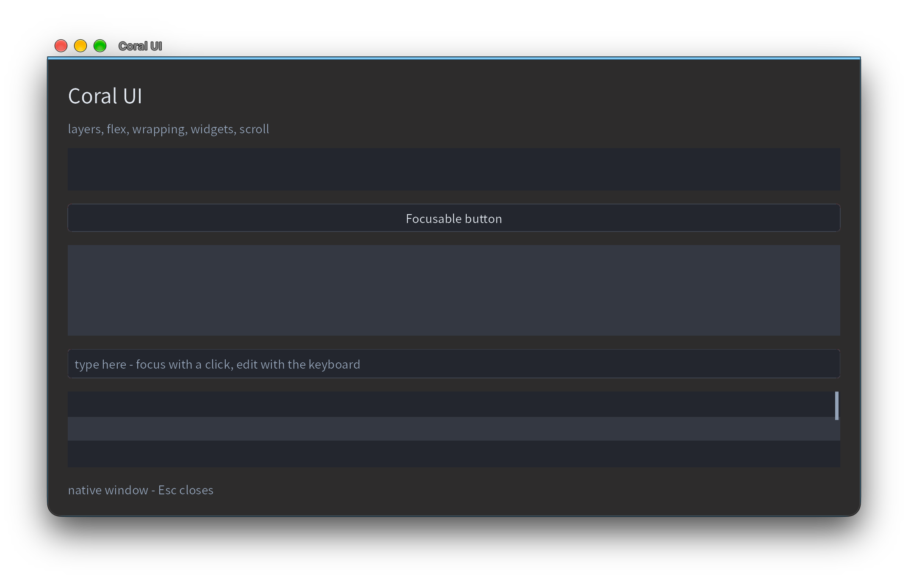

# macOS Manual Acceptance

Programmatic coverage lives in `ui_native_ax_smoke`; this checklist covers the parts that need a real
WindowServer surface, an interactive session and a human eye.

## Build and launch

```sh
cmake --preset macos-arm64-release   # or your existing out/examples configure
cmake --build out/examples --target ui_demo -j 10
open out/examples/ui/ui_demo.app --args --acceptance
```

`--acceptance` enables the Sidebar material and the content focus ring at startup so the first
screenshot covers both; the shortcuts below toggle them again.

The demo binds these shortcuts while it is the key window:

| Shortcut | Action |
| --- | --- |
| Cmd+Shift+M | Toggle `BackgroundMaterial::Sidebar` |
| Cmd+Shift+F | Toggle the native content focus ring |
| Cmd+Shift+P | Open the native print panel |
| Cmd+Shift+N | Request notification authorization, then post a notification |
| Cmd+Shift+C | `captureWindow()` and print the captured size |
| Cmd+Shift+G | Open `NSFontPanel`; the chosen face/size is printed |
| Cmd+Shift+S | Open the share sheet |
| Cmd+Shift+K | Open the native color panel; the selected RGBA is printed |
| Cmd+Shift+D | Print display colour space, EDR headroom, wide-colour and refresh rate |

## 1. Vibrancy / background material

1. Press Cmd+Shift+M.
2. Confirm the window content becomes translucent and the desktop blurs through it.
3. Press again to restore the opaque theme background.
4. Repeat in light and dark appearance.
5. Press Cmd+Shift+D and record `colorSpace/headroom/wideColor`; on an HDR display also run
   `--color-space linear-p3` and `--color-space hdr10` and confirm a higher headroom and HDR grant.
   On an SDR display the expected result is `colorSpace=0 hdr=0 headroom=1.00 wideColor=0`, which is
   the documented fallback rather than a failure.

Expected: no black/opaque rectangle behind the split view; the sidebar keeps its own sidebar material;
controls remain readable.

## 2. Content focus ring

1. Press Cmd+Shift+F.
2. Click the content view, then Tab through the demo controls.
3. Confirm AppKit's exterior focus ring is visible around the content view and does not flicker.
4. Press again and confirm the ring disappears.

Expected: the optional ring does not replace CoralUI's per-control focus drawing.

## 3. Print

1. Press Cmd+Shift+P.
2. Confirm the system print panel opens with a snapshot of the current frame.
3. First press Cancel and confirm the window returns to the normal frame.
4. Press again, choose "Save as PDF", and confirm the PDF contains the UI.
5. `printToFile` is the automated equivalent and writes `/tmp/coral-ui-print.pdf`.

Expected: the page contains the rendered UI, not a blank Metal view. Pagination of very tall windows is
not implemented; the snapshot is scaled to the print view.

## 4. Notifications

1. Press Cmd+Shift+N.
2. Accept the system authorization prompt when it appears.
3. Confirm the notification banner/center entry titled `Coral UI`.
4. The console prints `notification-authorization=<n>` and `postUserNotification=1`.
5. Re-run and confirm no repeated authorization prompt (the status is remembered by the system).
6. If the prompt was previously denied, change the demo bundle id or reset the app's notification
   permission in System Settings; notification permission is not a TCC service.

Expected: on a bundled app the UserNotifications path is used; command-line tools fall back to
`NSUserNotificationCenter` and may not show a banner.

## 5. ScreenCaptureKit window capture

1. Grant Screen Recording permission to the demo when prompted.
2. Press Cmd+Shift+C.
3. Confirm the console prints `captureWindow=1` with non-zero dimensions.
4. Revoke the permission in System Settings and confirm it returns `captureWindow=0` rather than hanging.

Expected: capture includes the native titlebar; the call blocks the UI for at most 10 seconds per stage.

## 5b. EDR / PQ / CADisplayLink

1. `system_profiler SPDisplaysDataType` should report an HDR-capable display if one is connected.
2. Launch with `--color-space hdr10` (or `linear-p3`) and press Cmd+Shift+D.
3. A grant is `colorSpace=3 hdr=1 headroom>1 wideColor=1`; the SDR fallback is
   `colorSpace=0 hdr=0 headroom=1`.
4. `refresh` should be close to the display's current rate (60/120). Move the window between displays
   to check that the current implementation still follows the main screen; per-window
   `CAMetalDisplayLink` is not wired yet.
5. CoralGraphics' `WindowSurfaceMac.PresentsInEveryGrantedColourSpace` and `FrameClock` tests cover the
   presentation math and display cadence.

## 6. Template tinting

`SystemImageOptions::tint` is covered by `ui_native_ax_smoke` for non-empty output. For a visual check,
draw a `systemSymbolImage(..., {.tint = theme.accent})` and confirm the symbol adopts the tint while
keeping its alpha.

## 6b. Window restoration

1. Set a restoration factory in the product before creating the window:

   ```cpp
   coral::ui::setWindowRestorationFactory([](std::string_view id) {
     // create the window with Options::restorationIdentifier = id
     return std::shared_ptr<Window>(Window::create(options).release());
   });
   ```

2. Launch the app, move/resize the window, quit normally, and relaunch.
3. Confirm AppKit asks the restoration factory for the identifier and the window returns at the
   restored frame/size.

The factory is kept process-wide; `CoralWindowRestoration` retains the returned `Window` for the
process lifetime. The current smoke only verifies the configuration; the relaunch flow is manual.

## 6c. Native toolbar and AppKit controls

Launch the toolbar acceptance mode:

```sh
open out/examples/ui/ui_demo.app --args --toolbar
```

The mode installs 18 NSToolbar items so overflow triggers even at the default 960pt width; the
`--native-disabled` variant additionally disables every native AppKit control, and `--ime-demo`
pre-fills the gallery's multiline input with CJK text and focuses it.

Then:

1. Resize the window narrow enough that the toolbar items no longer fit.
   - AppKit's overflow chevron appears.
   - The custom 1px separator is visible in unified style and is not merged away.
   - The Metal content keeps its correct logical size while the toolbar reflows.
2. Enter fullscreen (green button or Ctrl+Cmd+F).
   - The toolbar hides/shows with AppKit's fullscreen animation.
   - The CoralUI content view and split view resize with it; no stretched drawable remains.
3. Exit fullscreen and restore the previous window size.
4. In the gallery's "Native AppKit (live NSView only)" block:
   - The NSProgressIndicator bar shows the current value and the spinning indicator animates.
   - Clicking the NSStepper changes the bar through the C++ callback.
   - Toggle Value Wraps/Autorepeat if the demo is extended, and verify the native stepper behaviour.

Record the exact macOS version, display mode (SDR/HDR), and whether the window is sandboxed.

### 2026-11-24 result

- `--toolbar` at 960pt: AppKit shows the overflow chevron; the custom separator stays visible between
  Open and the flexible space rather than being merged away.
- Fullscreen: the window becomes 1920x1134 on the 1920x1200 secondary display. The content view and
  backing size update; the gallery page itself is a fixed 960x640 demo layout, so it remains
  top-left rather than stretching.
- Fullscreen auto-hide (`Window::setToolbarAutoHideInFullScreen`, default on): the toolbar hides on
  entry, appears when the pointer reaches the top edge, and hides again after the pointer moves back
  into the content. Moving the pointer to the other display does not always deliver a mouseExited to
  the fullscreen view; moving inside the view is the reliable path.
- Content insets: `Window::setSafeAreaChangedHandler` fires when titlebar/toolbar visibility changes.
  A custom fullSize content root can offset itself there. In fullscreen the window frame itself can
  move below the toolbar, so `safeAreaInsets().top` is often 0 even while the toolbar is visible;
  the handler is the reliable production hook.
- `--native-disabled`: the NSProgressIndicator/Stepper/SearchField/PopUpButton/Button/Switch render
  disabled and ignore interaction.
- `--ime-demo` + SCIM Pinyin: the multiline TextInput showed the candidate window (`你好`, `你好吗`, …)
  and Space committed `你好`; the final field contains `中文输入\n第二行你好`. This verifies real
  candidate-window and commit handling in the Cocoa NSTextInputClient path.

## 7. Font panel and share sheet

1. Cmd+Shift+G: choose a font; the console prints `font-panel: face=... size=...`.
2. Cmd+Shift+S: choose Copy and run `pbpaste` to confirm the text; choose another service to verify delivery.



## Status

The programmatic tests pass locally. A run on 2026-11-24 launched the demo and captured the window
with `screencapture -l`: a pure-zero clear initially made root-level `TextLayer`s disappear because
subpixel text wrote colour channels but not alpha. `TextPainter` now disables subpixel masks on
non-opaque targets and uses the alpha-bearing grayscale path, so `--acceptance` renders the title,
subtitle and footer correctly with an exactly-zero clear.

The native smoke also opens/closes `NSFontPanel`, drives a real font selection through
`setSelectedFont` + `changeFont:`, opens `NSSharingServicePicker`, and prints the window to a PDF
with `printToFile`. The print panel's own Print/Cancel buttons and the notification authorization
prompt still need a human click; record the macOS version, display/EDR headroom and each step's
result.
